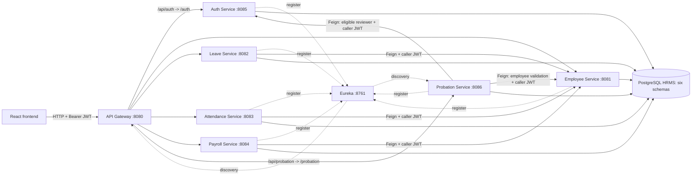
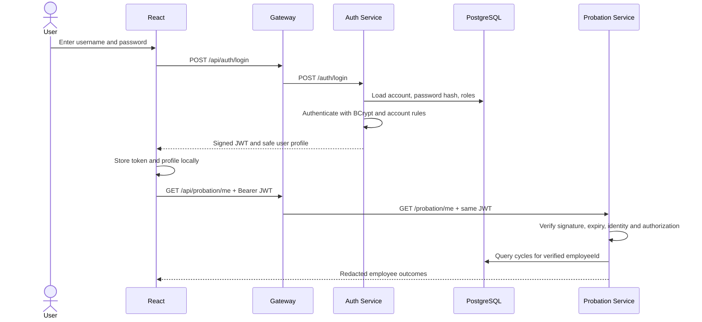
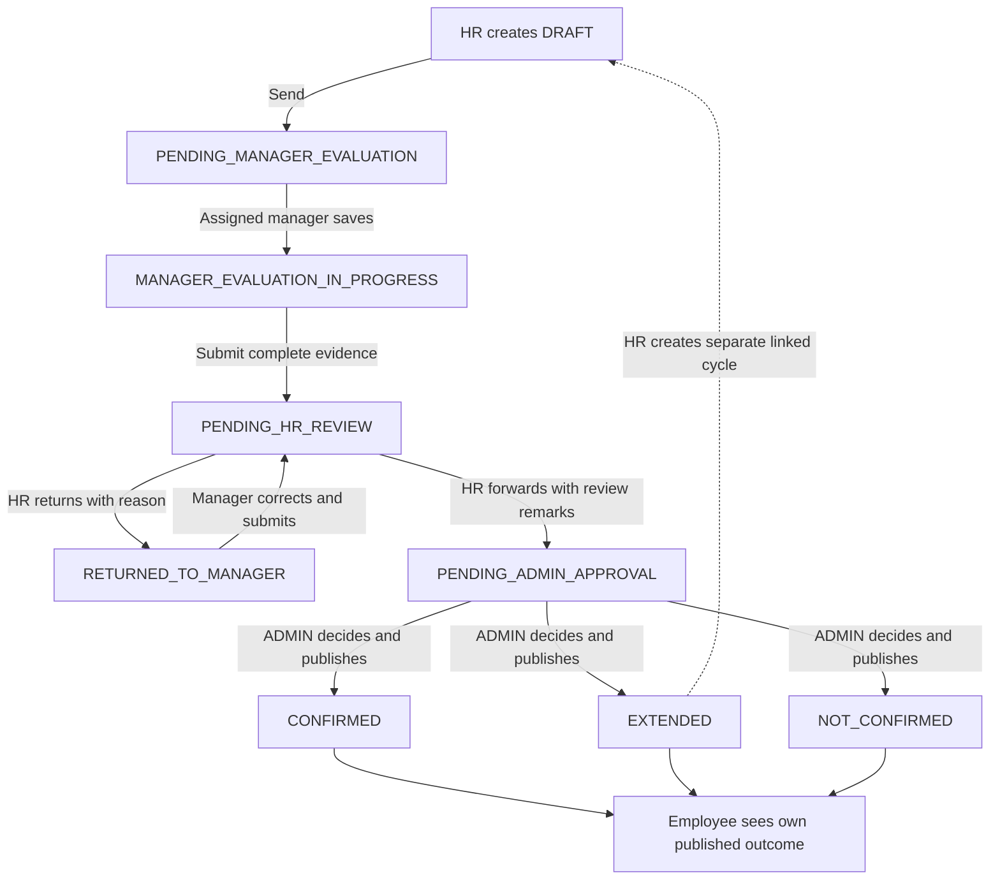

# HRMS Interview Preparation Handbook

**A practical guide to explaining, defending, and demonstrating this project**  
**Source review:** 10 November 2026  
**Scope:** Existing HRMS services, React application, and the implemented Probation Assessment module.

> Use this as a study guide, not a script to memorize. Explain only work you understand and contributions you can honestly describe. Examples below use fictional people and data. Suggested improvements are clearly separated from implemented behavior. No application code was changed to prepare this document.

## Contents

1. [How to use this handbook](#1-how-to-use-this-handbook)
2. [The project in one page](#2-the-project-in-one-page)
3. [How to introduce and present the project](#3-how-to-introduce-and-present-the-project)
4. [Architecture and request flows](#4-architecture-and-request-flows)
5. [What each module actually does](#5-what-each-module-actually-does)
6. [Probation: your strongest technical explanation](#6-probation-your-strongest-technical-explanation)
7. [API and permission reference](#7-api-and-permission-reference)
8. [Interview question bank: project and architecture](#8-interview-question-bank-project-and-architecture)
9. [Interview question bank: Java and Spring](#9-interview-question-bank-java-and-spring)
10. [Interview question bank: databases and concurrency](#10-interview-question-bank-databases-and-concurrency)
11. [Interview question bank: security](#11-interview-question-bank-security)
12. [Interview question bank: probation](#12-interview-question-bank-probation)
13. [Interview question bank: React](#13-interview-question-bank-react)
14. [Interview question bank: testing and operations](#14-interview-question-bank-testing-and-operations)
15. [How to explain your use of AI honestly](#15-how-to-explain-your-use-of-ai-honestly)
16. [Behavioral answers and your personal contribution](#16-behavioral-answers-and-your-personal-contribution)
17. [Debugging and design scenarios](#17-debugging-and-design-scenarios)
18. [Coding and SQL practice](#18-coding-and-sql-practice)
19. [Demonstration and verification checklist](#19-demonstration-and-verification-checklist)
20. [Limitations and a credible improvement plan](#20-limitations-and-a-credible-improvement-plan)
21. [Study plan, mock interview, and final revision](#21-study-plan-mock-interview-and-final-revision)
22. [Source files to study](#22-source-files-to-study)

## 1. How to use this handbook

This guide supports Java backend, Spring Boot, junior full-stack, and project discussion rounds. It covers common question categories; no document can predict every interview question.

| Time available | What to do |
| --- | --- |
| 30 minutes | Read sections 2, 3, 6, 15, and the final revision card in section 21. Speak the 90-second answer aloud. |
| Two hours | Add architecture, permissions, security, concurrency, and the debugging scenarios. Trace one real request in the code. |
| One week | Follow the study plan, solve the coding tasks without AI, run isolated verification, and complete the mock interview. |

For each technical answer, use **concept → project example → trade-off**. Start with a direct answer, explain a concrete class or request, then acknowledge one limit. Most first answers should take 20–45 seconds. Go deeper when the interviewer asks.

**Example:** “Optimistic locking prevents a stale write from replacing a newer one. Our probation assessment has a JPA `@Version` field, and mutation requests carry the last version the client saw. If two administrators decide concurrently, one commits and the other receives a conflict. The user must reload rather than silently overwrite the decision.”

Your preparation is complete when you can draw the architecture, trace a request, explain an authorization refusal, and implement a small rule without reading this guide.

## 2. The project in one page

### Business purpose

HRMS organizes employee information, leave requests, attendance records, payroll records, account access, and probation assessments. It provides different views and actions for ADMIN, HR, and EMPLOYEE accounts.

The probation module adds a structured review process: HR prepares an assessment, an explicitly assigned manager evaluates it, HR reviews it, ADMIN records the final outcome, and the employee sees their own published result.

### Current technology and service map

| Component | Technology / port | Responsibility |
| --- | --- | --- |
| `hrms-frontend` | React 19, Vite, Router, Axios / 5173 | Screens, role-aware navigation, forms, API calls |
| `api-gateway` | Spring Cloud Gateway / 8080 | Public API routing, load-balanced service discovery, CORS configuration |
| `discovery-server` | Netflix Eureka / 8761 | Service registration and discovery |
| `employee-service` | Spring Boot / 8081 | Employee master records; `employee_schema` |
| `leave-service` | Spring Boot / 8082 | Leave requests; `leave_schema` |
| `attendance-service` | Spring Boot / 8083 | Attendance and checkout records; `attendance_schema` |
| `payroll-service` | Spring Boot / 8084 | Salary components and payslip payment status; `payroll_schema` |
| `auth-service` | Spring Security, JWT / 8085 | Login, users, roles, reviewer directory; `auth_schema` |
| `probation-service` | Spring Boot / 8086 | Assessment workflow, ratings, decisions, history; `probation_schema` |
| PostgreSQL | Database: `HRMS` | One database containing six service-owned schemas |

The probation Maven configuration specifies Java 21, Spring Boot 4.1.1, and Spring Cloud 2025.1.3. Check each service's POM before quoting a version for the whole repository. Business services use JPA/Hibernate and blocking HTTP/database operations; the gateway uses the reactive gateway stack.

### Facts you must get right

- There are **six business services**, plus the gateway and discovery server.
- There is **one physical PostgreSQL database with six schemas**, not six independent databases.
- The gateway routes requests. The destination services validate JWTs and enforce permissions.
- “Reporting manager” is an assessment assignment to an eligible EMPLOYEE account, not a global MANAGER role.
- HR can write in probation. HR remains read-only in Employee, Leave, Attendance, and Payroll.
- Probation scores inform reviewers. They never automatically determine the final decision.
- A probation outcome does not terminate employment, disable an account, or modify payroll.
- AI assisted development. The running HRMS has no AI model or automated AI employment decision engine.

### Implemented versus not implemented

| Area | Implemented | Do not claim |
| --- | --- | --- |
| Authentication | BCrypt login, signed JWTs, role and ownership checks | Refresh-token rotation, immediate global token revocation, MFA |
| Leave | Request CRUD; new requests are PENDING; employee ownership rules | A complete approval/rejection workflow or leave-balance policy engine |
| Attendance | Record management and checkout action | Employee self-service attendance writes or biometric integration |
| Payroll | Components, net calculation, PENDING/PAID record handling | Bank transfers, statutory tax compliance, a payment gateway |
| Probation | Complete implemented review/decision cycle and linked extension cycle | Automated termination, score-based approval, an appeal/amendment workflow |
| Notifications | In-app queues and status indicators | Email, SMS, scheduled reminders, event-bus delivery |
| Deployment | Local configuration and verification tooling | Proven production deployment, Kubernetes, high availability, measured scale |

## 3. How to introduce and present the project

### A safe personal introduction

Replace the brackets with facts from your own experience:

> “Hello, my name is [name]. I am [your actual education or current role], and I am preparing for [role]. My main project is an HRMS using Java, Spring Boot, PostgreSQL, and React. It helped me study API design, authentication, ownership checks, and business workflows. The latest module is probation assessment, which includes manager evaluation, HR review, and an administrator's final decision. I used AI assistance during development, and I am focusing on understanding and verifying the implementation.”

Do not add a degree, employer, team size, duration, production usage, or personal contribution that you cannot substantiate.

### 30-second project answer

> “HRMS is a Java and React application for employee records, leave, attendance, payroll, and probation reviews. The backend has six business services behind a Spring Cloud Gateway, with Eureka for discovery and PostgreSQL schemas for service ownership. Spring Security and JWT control access. Its most detailed workflow is probation: an assigned manager evaluates, HR reviews, and ADMIN publishes the final decision.”

### 90-second project answer

> “My project is an HRMS built with Java, Spring Boot, PostgreSQL, and React. It organizes employee records, leave requests, attendance, payroll records, and probation assessments.
>
> The frontend calls a Spring Cloud Gateway. The gateway routes to services registered with Eureka, and the services validate JWTs and enforce role and employee ownership rules. Each business service owns a schema inside the same PostgreSQL database. That gives logical separation, although the database remains a shared resource.
>
> The latest module is probation assessment. HR creates a draft and assigns an eligible reporting manager. Only that assigned account can save and submit the evaluation. HR can return it for corrections or forward it to ADMIN. ADMIN records Confirmed, Extended, or Not Confirmed, and the employee receives only their own published outcome.
>
> The important engineering parts are server-side assignment checks, explicit status transitions, version-based concurrency control, database overlap protection, and audit history. AI helped substantially with implementation, tests, debugging, and documentation. The running application itself uses deterministic rules and human decisions. I can explain the relevant code and its current limitations.”

Say the final sentence only after completing the source-study and practice steps below.

### A 3–5 minute discussion structure

| Time | Explain | Evidence to show if asked |
| --- | --- | --- |
| 0:00–0:30 | Business problem and users | Module list and permission matrix |
| 0:30–1:15 | Architecture and one request | Gateway route, controller, service, repository |
| 1:15–2:30 | Probation lifecycle and authorization | Workflow rules, assignment check, redacted DTO |
| 2:30–3:15 | Concurrency and audit | `@Version`, SQL constraints, history insert |
| 3:15–4:00 | Verification and one real challenge | Integration test and isolated test runner |
| 4:00–5:00 | Honest contribution, AI use, next improvement | Concrete source and limitations |

Avoid starting with every dependency or reciting all ports. Lead with what the system does, then explain why the technical choices matter.

### If you do not know the answer

> “I have not implemented that in this project. My current understanding is [what you know]. I would check [specific behavior or evidence] before choosing an approach.”

If you forget a method name, explain the behavior first. If the interviewer corrects you, acknowledge the correction and apply it. Accuracy is more persuasive than pretending to know everything.

## 4. Architecture and request flows

### Whiteboard architecture



**Explain it:** “The browser has one API entry point. Services register with Eureka, so routing uses service names. Every business service owns its tables. Cross-service validation uses HTTP clients with the caller's token, rather than reading another schema.”

Gateway `StripPrefix=1` removes the first path segment: `/api/probation/assessments` becomes `/probation/assessments`. Feign calls go directly to discovered services; they do not travel through the public gateway in this design.

### Login and authenticated request



### Controller → Service → Repository

| Layer | Responsibility | Probation example |
| --- | --- | --- |
| Security filter | Establish verified caller identity | `JwtAuthenticationFilter` |
| Controller | Map HTTP routes; validate request DTOs | `ProbationController` |
| Service | Authorize ownership; apply rules; manage transaction | `ProbationServiceImpl` |
| Rule/catalog classes | Validate transitions, evidence, dates; calculate scores | `WorkflowRules`, `Criteria` |
| Feign directory | Validate external references through APIs | `ReferenceDirectory` |
| Repository | Query/save owned entities | `AssessmentRepository`, `HistoryRepository` |
| Mapper | Return the information this caller may see | `AssessmentMapper` |
| Exception handler | Convert failures into safe HTTP responses | `GlobalExceptionHandler` |

**Trace HR creation:** JWT verification → HR method permission → validated `CreateAssessment` → employee/reviewer lookups → period/assignment checks → criterion snapshots → assessment save and audit insert in one local transaction → `201 Created` DTO.

## 5. What each module actually does

### Employee

Stores employee identity and department information. ADMIN manages records; HR can read the directory. An EMPLOYEE account can access its linked profile, not the complete employee directory. The account's `employeeId` is a link to an employee record; account ID and employee ID are different identifiers.

### Leave

ADMIN and EMPLOYEE can create/update/delete requests, while HR reads them. An employee is restricted to their own records and can update/delete only PENDING requests. Creation sets status to PENDING. Employee existence is validated through Feign. The current controller does not implement approve/reject actions.

### Attendance

ADMIN manages attendance and records checkout. HR reads records; EMPLOYEE reads their own. The service checks for an existing record for the employee/date before writing. PRESENT requires check-in. The dedicated checkout action rejects a checkout earlier than check-in. Do not assume that this chronology rule is consistently enforced by every create/update path.

### Payroll

ADMIN manages records; HR reads them; EMPLOYEE sees their own. Net salary is calculated with `BigDecimal`:

```text
netSalary = basicSalary + allowances - deductions
```

The service checks duplicate employee/month records. New records are PENDING. Marking one PAID records payment status/date; it does not move money. PAID records cannot be edited/deleted through the ordinary service methods. These checks are not equivalent to the stronger concurrency guarantees implemented for probation.

### Auth

Authenticates credentials, hashes passwords with BCrypt, issues JWTs, and manages accounts and roles. User management is ADMIN-only. A narrowly scoped HR/ADMIN reviewer directory exposes eligible, enabled, employee-linked EMPLOYEE accounts without exposing password hashes or broad account-management access.

### Probation

Manages complete review cycles, assignments, evidence, HR review, final decisions, employee publication, and history. It validates external IDs through authorized APIs, stores useful display/criterion snapshots, and makes no changes to other services' employee, payroll, or account records.

## 6. Probation: your strongest technical explanation

### Workflow



The diagram summarizes the main flow. Saving an evaluation from RETURNED_TO_MANAGER changes it to MANAGER_EVALUATION_IN_PROGRESS. Final records stay final; an extension's later evaluation is a new linked record.

### Real-world example you can speak

Consider **Asha**, employee ID `101`, assessed from **1 January to 31 March 2027**, with review due **20 March**. **Ravi** has user ID `42`, linked employee ID `202`, and role EMPLOYEE. The values are illustrative; they are not seeded credentials or real people.

1. HR creates a draft for Asha and selects Ravi from the eligible reviewer directory. The service validates Asha, Ravi's account, Ravi's employee link, and the dates. Ravi cannot be Asha.
2. HR sends the draft. Only Ravi's matching verified user ID and employee link authorize manager evaluation.
3. Ravi saves scores and comments. Partial drafts are allowed. A final submission needs all eight scores, criterion comments, strengths, improvement areas, development recommendations, and a recommendation.
4. Suppose the eight equal-weight scores are `4, 4, 3, 4, 5, 4, 3, 5`. Their sum is `32`; the server computes **4.00**. A browser-supplied average is irrelevant.
5. HR reviews the evidence. If a comment needs clarification, HR returns the assessment with a reason; Ravi corrects and resubmits. HR then forwards it with review remarks.
6. ADMIN reviews the evidence and selects CONFIRMED, with optional employee-facing comments. The service records the actor, decision time, publication time, final state, version change, and history atomically.
7. Asha sees her period, status, and published comments. She does not receive Ravi's draft comments, HR deliberations, or the internal audit payload.

**Extension variant:** ADMIN selects EXTENDED, gives a reason, and approves **30 April 2027**. The existing cycle becomes final. HR may create one linked follow-up from **1 April through 30 April**, with a review due date inside that period. The old record is not reopened, and the new cycle is not created automatically.

### Assessment data model

| Table | Stores | Important protections |
| --- | --- | --- |
| `probation_assessments` | External IDs, display snapshots, period, state, feedback, decision, publication, previous cycle, audit metadata, version | Date/state checks, overlap exclusion, unique previous-cycle link, optimistic locking, final-record trigger |
| `probation_assessment_ratings` | Criterion code, name/weight snapshot, score, comments, timestamps | Internal assessment FK, unique criterion per assessment, score 1–5 when present, finalized-rating protection |
| `probation_assessment_history` | Action, previous/new state, actor, time, remarks, evidence snapshot | Internal assessment FK, append-only behavior and mutation-rejection trigger |

The central `Criteria` catalog starts with eight equal-weight criteria. Names, weights, and policy version are snapshotted into each assessment. Changing future criteria must not rewrite the meaning of a completed cycle. There is no criteria-administration screen/API yet.

### Four rules worth demonstrating in code

1. **Assignment is authorization:** compare the stored manager user ID and employee link with verified JWT identity. A reviewer ID in a request is not proof of who called.
2. **Transitions are explicit:** a valid ADMIN token cannot decide a DRAFT; the current state must be PENDING_ADMIN_APPROVAL.
3. **Concurrent changes conflict:** client version checks plus JPA optimistic locking prevent a stale decision from replacing a newer one.
4. **Evidence and outcome are separate contracts:** an employee receives `EmployeeOutcome`, not a full internal object with fields hidden by React.

### Persistence strategy

Probation uses Flyway migrations and Hibernate `ddl-auto=validate`. V1 creates the three tables and initial protections. V2 protects final ratings. V3 makes complete final-decision metadata explicit under PostgreSQL's NULL-aware CHECK behavior. Applied migrations should not be edited; future schema changes need a new migration.

The original modules still use Hibernate schema update configuration. Do not describe Flyway as a repository-wide migration strategy.

## 7. API and permission reference

### Role matrix

| Action | ADMIN | HR | EMPLOYEE |
| --- | --- | --- | --- |
| Employee directory | Read/write | Read | Own linked profile only |
| Leave | Read/write | Read | Own requests; own PENDING edits/deletes |
| Attendance | Read/write | Read | Own reads |
| Payroll | Read/write | Read | Own reads |
| Account administration | Yes | No | No |
| Create/edit/send probation draft | No in current endpoints | Yes | No |
| Read internal probation evidence | All | All | Assigned reviewer, scoped evidence only |
| Evaluate probation | No by ADMIN role alone | No by HR role alone | Only explicit eligible assignment |
| Return/forward probation | No in current endpoints | Yes | No |
| Reassign before HR review | Yes | Yes | No |
| Final probation decision | Yes, with workflow and conflict checks | No | No |
| Own probation status/outcome | Via `/me` if employee-linked | Via `/me` if employee-linked | Own redacted cycles |

ADMIN is not an automatic bypass for every business action. Current create/send/review endpoints specifically require HR. Eligible reviewers are EMPLOYEE accounts. Do not invent an implicit role hierarchy.

### Important public endpoints

All paths include the gateway's `/api` prefix. Individual services receive the path after that prefix is stripped.

| Area | Examples |
| --- | --- |
| Login/profile | `POST /api/auth/login`, `GET /api/auth/me` |
| Accounts | `/api/auth/users`, `/api/auth/users/{id}`, `PATCH .../{id}/role`, `PATCH .../{id}/status` |
| Employees | `/api/employees`, `/api/employees/{id}`, `GET /api/employees/me` |
| Leave | `/api/leaves`, `/api/leaves/{id}` |
| Attendance | `/api/attendance`, `/api/attendance/{id}`, `PATCH .../{id}/checkout` |
| Payroll | `/api/payroll`, `/api/payroll/{id}`, `PATCH .../{id}/paid` |

Probation paths below are relative to `/api/probation`:

| Method | Path | Purpose / permitted actor |
| --- | --- | --- |
| POST | `/assessments` | HR creates DRAFT; returns 201 |
| GET | `/assessments` | Office summaries or employee's own redacted cycles |
| GET | `/assessments/{id}` | Caller-specific authorized detail |
| PUT | `/assessments/{id}` | HR updates DRAFT dates and initial remarks |
| GET | `/employees/{employeeId}/history` | Office cycle history or subject's own cycles |
| GET | `/manager/assignments` | Verified caller's sent reviewer assignments |
| PUT | `/assessments/{id}/evaluation` | Assigned manager replaces current evaluation draft |
| POST | `/assessments/{id}/submit-evaluation` | Assigned manager submits complete evidence |
| POST | `/assessments/{id}/send-for-evaluation` | HR sends DRAFT |
| POST | `/assessments/{id}/return-to-manager` | HR returns with required reason |
| POST | `/assessments/{id}/forward-for-approval` | HR forwards with review remarks |
| POST | `/assessments/{id}/decision` | ADMIN decides and publishes |
| POST | `/assessments/{id}/reassign` | HR/ADMIN change editable assignment with reason |
| GET | `/me` | Own redacted cycles from JWT employee link |
| GET | `/statistics` | HR/ADMIN authorized counts and recent completions |
| GET | `/capabilities` | Whether caller has sent reviewer assignments |
| GET | `/criteria` | Central criterion definitions and rating labels |
| GET | `/employees` | HR/ADMIN employee selection via Feign |
| GET | `/reviewers` | HR/ADMIN paginated eligible reviewer selection |

Probation lists are zero-based, default to page size 20, and cap it at 100. Applicable lists support search/status/employee filters. The response shape is `{ content, totalElements, totalPages, page, size }`. The reviewer picker has its own default size of 50. Filtering never broadens ownership.

### Example payloads

These are contract examples, not commands to execute against real employee data. Use IDs returned by your isolated environment.

```json
{
  "employeeId": 101,
  "probationStartDate": "2027-01-01",
  "probationEndDate": "2027-03-31",
  "reviewDueDate": "2027-03-20",
  "reportingManagerUserId": 42,
  "initialRemarks": "Collect structured feedback before the review."
}
```

Every update/action on an existing assessment requires its latest returned `version`. Use `assessment.version` from internal detail responses; do not guess it.

```json
{
  "version": 7,
  "decision": "EXTENDED",
  "remarks": "Additional evidence is needed on the agreed improvement areas.",
  "revisedEndDate": "2027-04-30",
  "publishedComments": "Your probation is extended until 30 April. Discuss the development plan with your reporting manager."
}
```

Internal decision remarks and employee-published comments serve different audiences. Final publication occurs with the ADMIN decision, not through a later publish endpoint.

### REST follow-ups interviewers often ask

| Question | Concise answer connected to this project |
| --- | --- |
| GET versus POST? | GET reads without requesting a mutation. POST creates a resource or invokes a workflow action, such as forwarding for approval. |
| PUT versus PATCH? | PUT normally replaces the representation addressed by the contract; PATCH changes selected aspects. The evaluation PUT replaces the current draft; older checkout/payment actions use PATCH. |
| What is idempotency? | Repeating a request has the same intended effect as doing it once. GET is safe/idempotent; PUT and DELETE have idempotent HTTP semantics, although responses can differ. POST does not promise idempotency. |
| Are decision requests safely repeatable? | The current endpoint does not use an idempotency-key store. Version/state checks prevent duplicate finalization, and a repeat may return 409. After a timeout, fetch the latest assessment before taking another action. |
| Why 201 instead of 200 on create? | 201 communicates that a resource was created. Successful reads/actions return their current DTO with the status chosen by the controller. Do not claim every endpoint returns 204. |
| Why use action routes? | `send-for-evaluation` and `decision` expose specific workflow operations with narrow DTOs, rather than allowing clients to set any status through a generic update. |
| What is mass assignment? | Binding a broad entity could let a client set fields such as decision actor or status. Explicit request DTOs allow only fields relevant to that operation. |
| Why pagination? | It bounds response size and query work. Probation implements server pagination; older lists do not all provide the same pagination contract. |

### HTTP error vocabulary

| Code | Meaning in this module | Example |
| --- | --- | --- |
| 400 | Invalid input or incomplete evidence | Score 6; missing extension reason |
| 401 | Missing/invalid authentication | Expired or malformed JWT |
| 403 | Caller lacks role/ownership | Unassigned reviewer submits |
| 404 | Resource/reference does not exist | Missing assessment or employee |
| 409 | State/version/data conflict | Stale version; overlapping active cycle |
| 503 | Required reference validation unavailable | Feign dependency unavailable |

The probation error body is `{ timestamp, status, error, message }`. Clients receive safe messages rather than downstream response bodies, SQL details, or stack traces. Missing/ineligible reviewer selection is a 400 assignment error through probation, even though the reviewer directory itself can return 404.

## 8. Interview question bank: project and architecture

### Q001. What problem does your project solve?

It organizes core employee administration and review workflows in one application. Different users can manage or view employee records, leave, attendance, payroll, and probation according to their permissions. The probation module adds structured evidence and authorized decisions instead of a single editable status field.

### Q002. Why did you choose this project?

**Personalize:** “I wanted to understand how business rules, authentication, database design, and frontend behavior fit together. HRMS provides concrete cases where being logged in is not enough: users must also own the record or have an assigned responsibility.” Do not invent a client requirement or company deployment.

### Q003. Is this a production system?

It is an implemented project with automated checks and local verification tooling. I would not describe it as production-proven without operational evidence. Secrets, token lifecycle, broader migrations, observability, resilience, and deployment hardening still need work.

### Q004. Why microservices instead of a monolith?

The existing project separates business capabilities into independently runnable services. That makes ownership and API boundaries explicit and is useful for studying distributed systems. A modular monolith could be simpler for a small team; network failures, deployment overhead, and a shared database reduce some benefits here.

### Q005. What does the API Gateway do?

It provides a common API entry point, matches route prefixes, removes `/api`, and forwards to services discovered by name. It also hosts the existing CORS policy. This gateway is not the component that validates JWTs in the current implementation.

### Q006. Why use Eureka?

Services register their addresses so clients can discover instances by service name. The gateway can route to `lb://probation-service` without hardcoding its address. Eureka discovers endpoints; it does not implement business authorization or guarantee request success.

### Q007. What is OpenFeign used for?

Feign provides declarative HTTP clients. Probation validates an employee through employee-service and validates an eligible reviewer through auth-service. The current caller's JWT is relayed so downstream services can authorize those requests.

### Q008. What is a service boundary here?

A boundary is ownership of business rules, APIs, and data. Probation owns assessments and stores employee/user IDs as plain values. It does not map another service's employee entity or directly query employee tables, even though the tables share a database server.

### Q009. What happens when a downstream service fails?

A probation write that needs unavailable reference validation fails safely, and its local transaction does not commit an incomplete assessment/history change. General Feign failures are translated to a sanitized 503. Bounded timeouts exist for probation, but a full circuit-breaker/retry system is not implemented.

### Q010. Is Eureka required on every request?

Clients use registry information that can be cached; discovery does not necessarily mean a live registry round trip per business request. Existing registered instances may remain usable during a temporary registry outage. Exact behavior depends on client cache, refresh, instance health, and configuration; it is not unlimited availability.

### Q011. Are all services reactive?

No. The gateway uses Spring's reactive gateway stack, while business services use servlet request handling, blocking Feign calls, and JPA. A reactive gateway does not make downstream database operations nonblocking.

### Q012. What is the difference between load balancing and discovery?

Discovery supplies available service instances. Load balancing selects an instance for a request. `lb://` routes use service discovery and Spring Cloud load-balancing integration; neither replaces health checks or database capacity planning.

### Q013. Why do you avoid circular dependencies?

Circular service calls increase coupling and can create failure loops. Probation calls employee/auth reference APIs; those services do not call probation back to complete the same operation. Auth's reviewer endpoint exposes local account data without needing a probation dependency.

### Q014. How are errors consistent across services?

Controllers/services throw meaningful exceptions, and global exception handlers map them to HTTP status codes and JSON. Probation uses a standard timestamp/status/error/message shape and sanitizes downstream failures. Similar patterns exist in older services, but I would review each handler before claiming identical coverage everywhere.

### Q015. What is distributed consistency in this project?

An HTTP lookup and a local database save are not one atomic distributed transaction. Probation validates remote references, then commits its own data; a remote employee/account may change later. Snapshots preserve historical meaning, while stronger cross-service consistency would require an explicitly designed integration strategy.

## 9. Interview question bank: Java and Spring

### Q016. Why use Java and Spring Boot?

Java provides static types, mature libraries, and strong tooling. Spring Boot simplifies application configuration, dependency integration, and startup, while Spring Security, MVC, Data JPA, and Cloud support the project's API and infrastructure needs. Framework convenience does not remove the need to implement business and ownership rules.

### Q017. Explain dependency injection using your code.

`ProbationController` receives its service and reference directory through its constructor. Spring supplies the configured beans. Constructor injection makes dependencies explicit and allows tests to provide substitutes without the controller constructing them directly.

### Q018. What do Controller, Service, and Repository mean?

The controller handles HTTP and validated DTOs. The service enforces business rules, permissions, and transactions. The repository handles persistence. Putting manager ownership and transition checks in the service protects the rules beyond one particular route mapping.

### Q019. Why use DTOs instead of returning entities?

DTOs define a stable, intentional API contract and prevent clients from setting internal state. They also avoid exposing lazy relationships and confidential fields. In probation, `EmployeeOutcome` deliberately excludes manager evidence and HR notes; this is a security decision, not just formatting.

### Q020. What is a Java record, and where is it used?

A record is a concise data carrier with generated accessors, constructor, equality, and string representation. Probation request/response DTOs are records. Their references are final, but contained collections can still be mutable unless copied or wrapped; records are not automatically deeply immutable.

### Q021. Which OOP concepts are visible in the project?

Encapsulation keeps workflow changes inside service methods; interfaces such as `ProbationService` define contracts; implementations provide behavior; and domain entities model related state. Prefer explaining these concrete uses over claiming inheritance is the main design tool.

### Q022. How do checked and unchecked exceptions differ?

Checked exceptions require handling or declaration; unchecked exceptions extend `RuntimeException` and do not. Spring's usual transactional behavior rolls back on unchecked exceptions, unless configured otherwise. Business failures in probation use runtime exceptions mapped to safe HTTP responses.

### Q023. What does `@Transactional` guarantee?

It defines a local transaction for participating database work. A probation mutation and its audit insert commit or roll back together. It does not roll back a remote HTTP operation or create a transaction across services.

### Q024. Why can `@Transactional` fail on self-invocation?

Spring commonly implements transaction advice through a proxy. A call from another bean through that proxy can be intercepted, while an ordinary internal call on `this` does not create a new advised boundary. I would check proxy behavior and propagation before assuming an annotation changes a self-call.

### Q025. Why use `BigDecimal`?

Binary floating-point can represent decimal financial values imprecisely. Payroll uses `BigDecimal` for salary calculations, and probation calculates a rounded decimal weighted mean. Use decimal strings or exact integer conversion, and choose rounding explicitly when dividing.

### Q026. What is the difference between `==` and `.equals()`?

For object references, `==` checks identity; `.equals()` checks the class's defined value equality. IDs represented by boxed `Long` values should be compared with value equality, such as `Objects.equals`. Reference comparison can appear to work for cached small numbers and fail for larger ones.

### Q027. What collections would you use for criteria and roles?

A list preserves the defined order of criteria; a set expresses unique roles or unique submitted criterion codes. A map supports lookup by criterion code. Choosing a collection should follow the operation and uniqueness/order requirements, not just familiarity.

### Q028. How are streams useful here?

The score calculation filters scored ratings and sums weighted values. Streams make a small transformation readable, but they do not make it inherently faster. Parallel streams would be unnecessary for eight criteria and can be dangerous around request-thread security or persistence contexts.

### Q029. What do `@Valid` and validation annotations do?

They validate request structure and field-level constraints, such as positive IDs and scores between one and five. Cross-field and state-dependent rules still belong in the service/rule layer: end after start, extension requirements, and evidence completeness cannot be reduced to one field annotation.

### Q030. How are enums stored, and why does it matter?

Probation uses enum concepts for statuses and decisions, with human-readable values in the database. String storage is safer to evolve than ordinal positions, which can change meaning when enum order changes. Renaming a stored enum value still requires API and migration planning.

### Q031. Why not put all logic in the controller?

It would mix HTTP concerns with workflow, persistence, and authorization. The current separation lets workflow tests exercise rules directly and ensures a service operation enforces its own constraints. A thin controller is easier to review.

### Q032. Is a singleton service automatically thread-safe?

No. Spring may share one service instance between concurrent requests. Request-specific values should remain in local variables or request-bound security context, rather than mutable instance fields. JPA version checks protect database updates; they do not make arbitrary Java state thread-safe.

### Q033. Which Spring annotations should you explain confidently?

`@SpringBootApplication` starts configuration/component discovery; `@RestController` exposes response bodies; mapping annotations route HTTP; `@Service` and repository support organize beans; `@Transactional` defines transaction behavior; and `@PreAuthorize` adds method authorization. Explain where each is used, not only its definition.

### Q034. Why separate an interface and implementation?

It creates an explicit contract and makes alternative implementations or test substitutes possible. An interface alone does not guarantee loose coupling or good design; the contract must avoid exposing internal persistence details. This project follows that service pattern.

### Q035. What Java topics should you revise beyond the project?

Revise exception handling, generics, collection complexity, `equals`/`hashCode`, immutability, streams, JVM memory/GC basics, and concurrency. Being able to describe a Spring controller does not replace core Java knowledge. Section 18 provides small exercises to practice independently.

### Additional fundamentals to answer briefly

| Follow-up | Answer to practice |
| --- | --- |
| JDK, JRE, JVM? | The JVM executes bytecode; the runtime includes execution libraries; the JDK supplies development tools such as `javac`. This project needs an appropriate JDK to build Java services. |
| Spring versus Spring Boot? | Spring provides the framework and dependency container. Boot adds conventions, auto-configuration, starters, and application startup support. |
| IoC versus dependency injection? | Inversion of control means the framework controls creation/wiring and lifecycle. Dependency injection is the mechanism for supplying collaborators to a bean. |
| `@Component`, `@Service`, `@Repository`? | They identify component roles for discovery; service names business logic, while repository semantics also support persistence exception translation. They are not substitutes for transactions or permission checks. |
| `@Bean` versus component scanning? | `@Bean` registers an object returned by a configuration method; scanning discovers annotated classes. Security configuration uses bean methods to construct framework objects. |
| `@Primary` versus `@Qualifier`? | They resolve competing beans: a primary default versus an explicitly selected dependency. Explain the concept without claiming this project requires multiple implementations. |
| JPA, Hibernate, Spring Data JPA? | JPA defines persistence contracts; Hibernate implements them; Spring Data JPA supplies repository abstractions on top. They are related, not interchangeable names. |
| `final`, `finally`, `finalize`? | `final` restricts reassignment/extension/overriding depending on context; `finally` runs cleanup around a try; finalization is obsolete and should not be used for resource management. Use try-with-resources where appropriate. |
| Overloading versus overriding? | Overloading changes parameter lists at compile-time selection; overriding provides subtype behavior for an inherited method contract. |
| `volatile` versus locking? | Volatile provides visibility/order guarantees for a field; it does not make a compound increment or a multi-step database workflow atomic. |
| Maven lifecycle? | `test` runs tests, `package` normally includes prior phases and builds the artifact, `verify` includes subsequent verification hooks, and `install` puts the artifact in the local repository. A package build is not deployment. |
| ACID? | Atomicity, consistency, isolation, durability describe database transaction properties. They apply to participating database operations, not every HTTP call made by a service. |
| WHERE versus HAVING? | WHERE filters rows before grouping; HAVING filters grouped results. Use GROUP BY for queue counts and HAVING for conditions on those counts. |
| Offset versus cursor pagination? | Page/size is simple and currently used by probation; deep offsets and changing data can make it inefficient or unstable. Cursor pagination is a possible future option requiring a stable ordering contract. |

## 10. Interview question bank: databases and concurrency

### Q036. Why PostgreSQL?

It supports relational constraints, transactions, indexes, schemas, date ranges, and the exclusion constraint used by probation. Those capabilities fit structured workflow data and concurrency protection. The choice is supported by project needs; I would not claim it is universally better than every other database.

### Q037. Is this database-per-service architecture?

It has service-owned schemas in one shared database. That gives logical ownership but not full physical database independence. A database outage, resource pressure, or overly broad credentials can affect multiple services.

### Q038. Can PostgreSQL create a foreign key across schemas?

Yes, when the schemas are in the same database and permissions allow it. This project intentionally avoids cross-service foreign keys to preserve ownership boundaries. It is an architectural choice, not a PostgreSQL limitation.

### Q039. Does `hibernate.default_schema` provide security isolation?

No. It controls the namespace used for mappings. Database privileges require suitable users and grants. Separate schema names do not stop an account with broad permissions from accessing other schemas.

### Q040. What is normalization, and why store snapshots?

Normalization reduces repeated operational facts and update anomalies. Probation deliberately stores employee display and criterion snapshots so historical reviews remain understandable after external names or policy definitions change. That is intentional duplication for audit meaning, not an excuse to duplicate every external record.

### Q041. What are the probation entity relationships?

An assessment owns its rating records, and history records refer to their assessment. These relationships stay inside probation's schema. Employee and user references remain plain IDs rather than JPA relationships to another service.

### Q042. What are lazy loading and the N+1 problem?

Lazy loading fetches a relationship when accessed, which can produce many additional SQL queries while looping over entities. A separate issue exists here: older list responses call employee-service once per row, creating an **HTTP N+1** pattern. ORM fetch joins do not fix network-per-row composition.

### Q043. Which indexes does probation use?

The migrations include indexes for status/due-date queues, manager/status lookup, employee history, and assessment event history. Indexes should follow real query predicates and ordering. Their value should be checked with execution plans and realistic data; indexes also increase write/storage cost.

### Q044. Why is a “check then insert” duplicate test insufficient?

Two transactions can both observe no existing row and then both insert. Attendance/payroll have application checks but lack corresponding composite uniqueness declarations in their entity mappings. Probation adds a database exclusion constraint so concurrent overlapping active periods cannot both commit.

### Q045. How does the overlap constraint work?

It excludes rows whose employee-ID ranges and inclusive date ranges overlap, while `final_decision IS NULL`. Representing a single employee ID as an integer range lets built-in GiST range operators protect equality and period overlap without adding an extension. It blocks overlapping **active** cycles, not every historical date overlap.

### Q046. What is optimistic locking?

JPA tracks an assessment's version and includes it in an update condition. A stale write affects no matching versioned row and raises a conflict. This works across application instances because the database update is conditional, rather than relying on an in-memory lock.

### Q047. Why also send the version in the request?

The request version identifies the revision the user actually reviewed. Without it, the server might load the latest row and apply a decision from an outdated browser view. The explicit comparison protects that intent; `@Version` also protects a race after the row was loaded.

### Q048. Can two administrators finalize the same assessment?

Both may initially see the same eligible state/version, but only one versioned update can commit. The other gets a 409, and its audit event rolls back. A later retry also fails because the assessment is already final. The integration suite has a concurrent-decision test.

### Q049. Would a Java `synchronized` block solve this?

It would only coordinate threads using that lock in one JVM. It does not protect another service instance or a database client. Database constraints and conditional updates are the appropriate shared enforcement boundary here.

### Q050. Why use both application rules and database constraints?

Application rules provide clear messages and enforce workflow context. Constraints protect stored invariants against races and other writers. Neither layer alone expresses every requirement; they reinforce each other.

### Q051. What is special about SQL CHECK and NULL?

PostgreSQL CHECK constraints reject false expressions, but an unknown/NULL expression can pass. Final-decision metadata must therefore be expressed to handle nullable branches deliberately. Probation's V3 migration explicitly checks final and nonfinal cases rather than assuming a comparison with NULL is false.

### Q052. What is `saveAndFlush` used for?

It sends pending persistence changes to the database before the transaction ends, so version and constraint errors can surface during the workflow operation. Flush is not a commit; a subsequent history failure can still roll back the transaction.

### Q053. Is audit history tamper-proof?

The application appends events, and database triggers reject ordinary history updates/deletes. That is stronger than a UI convention. It is not cryptographic tamper evidence against a database superuser who can change triggers or permissions; stronger requirements need a separate design.

### Q054. What isolation level is used?

The code does not request a special isolation level for probation transactions. It uses the configured datasource/database behavior; PostgreSQL commonly defaults to READ COMMITTED. I would verify the running setting rather than claim SERIALIZABLE. Correctness here relies on constraints and versioning, not an assumed stronger isolation level.

### Q055. How do migrations differ from Hibernate schema update?

Flyway applies ordered, versioned SQL changes with recorded history. Hibernate update infers changes from mappings and is less suitable as a controlled production change record. Probation uses Flyway plus validation; migrating the older modules would need a careful baseline and separate work.

## 11. Interview question bank: security

### Q056. What is authentication versus authorization?

Authentication establishes who the caller is. Authorization determines what that verified caller may do. A valid EMPLOYEE token authenticates a user but does not authorize evaluation of an unassigned employee.

### Q057. Explain JWT login in this project.

Auth-service authenticates a username/password through Spring Security and BCrypt-backed user details. It issues a signed token with subject, user ID, roles, optional employee ID, and issued/expiry times. Later services verify the signature/expiry and create a request security context.

### Q058. Is a JWT encrypted?

A normal signed JWT is not confidential encryption; its payload can be decoded. The signature detects unauthorized changes. Never put passwords, secret feedback, or sensitive records into claims merely because the token is signed.

### Q059. Which signing algorithm is used?

The code creates an HMAC key and uses JJWT's `signWith(key)` behavior to select a compatible algorithm. I would inspect the real token header/configuration before naming a fixed HS variant. Older comments alone are not evidence that every token uses HS512.

### Q060. Can only auth-service sign tokens?

Only auth-service issues them by application design. Because services share an HMAC secret for verification, a holder of that secret can also sign cryptographically valid tokens. Asymmetric signing with a private issuer key and public verification keys would reduce that trust exposure.

### Q061. What does the probation JWT filter validate?

It verifies signed claims and expiry and requires a nonblank subject, positive user ID, and exactly one supported role. If an employee claim exists, it must be positive. It creates a typed `CurrentUser`; malformed or invalid identity leaves the request unauthenticated.

### Q062. Why distinguish `userId` from `employeeId`?

The user ID identifies the login account; the employee ID identifies the HR record. Reviewer assignment belongs to a verified account with a matching employee link. Treating these identifiers as interchangeable could authorize the wrong person.

### Q063. Why not trust a reviewer ID from React?

The browser can be modified. A submitted ID can identify a proposed assignee in an HR action, but it cannot identify the caller. Evaluation permissions come from the verified token compared with the stored assignment.

### Q064. How do you stop IDOR or cross-employee access?

The server checks ownership before returning or mutating restricted records and scopes list queries by verified identity. Probation also maps subject responses to an outcome-only DTO. Changing a URL ID or filter must not expose another employee's confidential data.

### Q065. Is a hidden button a security control?

No. React route guards and navigation reduce confusion, but users can call HTTP endpoints directly. Backend role, ownership, workflow, and assignment checks remain mandatory.

### Q066. What is the difference between 401 and 403?

401 means authentication is missing or invalid. 403 means a caller is authenticated but lacks permission. An expired JWT should lead to authentication handling; a valid HR token attempting a final decision is forbidden.

### Q067. Why is CSRF disabled?

The current API uses a stateless bearer token supplied in an Authorization header rather than browser-automatically-attached session authentication. That changes the CSRF threat model. If authentication moved into cookies, CSRF protections would need review; disabling CSRF does not protect against XSS.

### Q068. What does CORS protect?

It tells browsers which origins may read cross-origin responses. It is not authentication and does not stop Postman or a direct HTTP client. Server authorization is required regardless of CORS settings.

### Q069. What is the localStorage token trade-off?

It is simple and survives page reloads, but JavaScript running after an XSS vulnerability can read it. The current frontend uses localStorage. A stronger design would evaluate an HttpOnly cookie/BFF approach, XSS controls, and the resulting CSRF/session requirements together.

### Q070. What happens when a user logs out or is disabled?

Frontend logout removes local authentication state. Existing JWTs are not centrally revoked by that action, and services generally do not reread account status for every request. A previously issued token can remain valid until expiry; role changes can also remain stale in its claims.

### Q071. Does `/auth/me` renew a token?

No. It reloads the user profile for the frontend; it does not issue a fresh access token. The source config uses a 24-hour access-token expiration. Refresh tokens and a revocation design are not implemented.

### Q072. How is authorization preserved during Feign calls?

`FeignTokenRelay` places the verified caller's token into the outbound Authorization header. The downstream service applies its own rules. Managers use the permitted assessment snapshot instead of being granted employee-directory access just to render another employee's review.

### Q073. How would you improve security next?

Externalize and rotate exposed/default secrets, add stronger token lifecycle controls, restrict database credentials, review older JWT filters, and add production transport and monitoring controls. The auth filter's broad exception handling around downstream processing deserves particular review. I would not weaken permissions to make integration easier.

## 12. Interview question bank: probation

### Q074. Why is probation a separate service?

It owns a distinct lifecycle with confidential evaluations, review roles, final decisions, and audit requirements. Adding it through existing gateway, discovery, security, and Feign conventions avoids mixing these rules into employee CRUD. The shared database still limits physical independence.

### Q075. Why not add a MANAGER role?

A company role would grant broad capability to many people who are not responsible for a particular assessment. Explicit assignment allows an eligible EMPLOYEE account to review only assigned cycles. It solves this requirement without changing the project's three-role model.

### Q076. Who is eligible to be assigned?

An enabled EMPLOYEE account with an employee link, selected through the restricted auth directory. Probation validates the linked employee record as well. The reviewer cannot be the assessed employee.

### Q077. Can a manager evaluate an assessment still in DRAFT?

No. A draft belongs to HR preparation; reviewer access starts after HR sends it. Manager operations also require a permitted manager-evaluation state and a matching stored assignment.

### Q078. What is allowed in a draft evaluation?

Partial scores and written feedback can be saved, and the server calculates a provisional mean using scored criteria. Unknown/duplicate criterion codes and out-of-range scores are rejected. Saving replaces the current draft rather than silently merging unspecified criterion values.

### Q079. What is required to submit?

All eight scores, a comment for each criterion, strengths, areas for improvement, development recommendations, and a manager recommendation. Draft flexibility does not imply incomplete submissions are allowed. The server checks completeness independently of React validation.

### Q080. How is the score calculated?

The server sums score × snapshotted weight and divides by the total scored weight, rounding to two decimal places with HALF_UP. Initial weights are equal. Submitted evaluations must have every criterion; draft averages can be incomplete and are provisional.

### Q081. Does a high score automatically confirm an employee?

No. No arbitrary threshold determines employment outcomes. The score and written evidence support HR and ADMIN review, and only an authorized ADMIN records the final decision after the required workflow.

### Q082. Can HR bypass manager evaluation?

No administrative bypass is implemented. HR must obtain a complete manager submission and review it before forwarding. HR cannot call the final-decision action successfully.

### Q083. Can ADMIN create a draft or forward as HR?

Not through the current HR-only endpoints. ADMIN can view evidence, reassign permitted cycles, and decide forwarded assessments. Do not assume ADMIN implies every other role when the code explicitly requires HR.

### Q084. What happens when HR returns an evaluation?

The state changes from PENDING_HR_REVIEW to RETURNED_TO_MANAGER, with required correction remarks and an audit event. The assigned manager can revise and resubmit. HR does not edit the manager's ratings directly.

### Q085. How does reassignment preserve evidence?

HR/ADMIN can reassign only during draft/manager-editable states and must provide a reason. The service archives the current evidence in history, validates the new reviewer, clears the active evaluation, and removes the old reviewer's assignment access. Submitted HR-review work must first be returned before reassignment.

### Q086. What if the manager's account later becomes ADMIN?

The final-decision service rejects a caller whose user ID matches that assessment's assigned reviewer, even after a role change. This prevents that reviewer from issuing the final decision on their own evaluation. Old-token role freshness remains a separate limitation.

### Q087. How is an extension modeled?

EXTENDED is a final decision on the original cycle, with a required reason and a revised end date later than the original end. HR can create one separate linked cycle with the approved period. The previous record remains immutable; extension is not a hidden reopen operation.

### Q088. What can the employee see?

Their own assessment dates, workflow status, and final published decision/comments, including a revised date when applicable. They do not receive criterion ratings, draft feedback, HR deliberations, internal decision reasons, or audit evidence. The API enforces this through a distinct DTO.

### Q089. How does publication happen?

ADMIN decision and publication metadata are written atomically. The published comments field is intentionally separate from internal decision remarks. There is no separate “publish later” action in this release.

### Q090. Why keep an audit trail if rows already have timestamps?

`updatedAt` only describes the latest state. History records who performed each action, the old/new state, reason, time, and evidence snapshot. This preserves the sequence and earlier evidence, including changes across corrections or reassignment.

### Q091. Can a finalized assessment be corrected or deleted?

There is no ordinary delete or final-amendment API. Service transition rules reject mutations, and database triggers protect final assessments/ratings. A future correction or appeal process would need an explicit approved design with preserved history.

### Q092. What does NOT_CONFIRMED do to the employee?

It records and publishes that assessment outcome, with a required internal reason. It does not terminate employment, disable login, or change payroll. Those actions require separate business policy and approved integration.

## 13. Interview question bank: React

### Q093. How is the frontend organized?

Pages provide routes and screen composition; reusable components provide layout and controls; API modules wrap Axios calls; hooks manage query/action state; AuthContext supplies authentication state. Probation extends these existing patterns and plain CSS tokens rather than introducing another design system.

### Q094. How is authentication state managed?

AuthContext reads the locally stored token/profile, provides login/logout and role helpers, and loads `/auth/me` to refresh profile information. Axios attaches the bearer token. A profile refresh does not replace the token or fix stale signed role claims.

### Q095. What happens on 401 versus 403 in the UI?

For protected API calls, the Axios interceptor handles 401 by clearing the token and navigating to login. Login failures stay available for inline feedback. A 403 is shown as an authorization failure rather than automatically logging the user out.

### Q096. Why use custom hooks?

They centralize query/action state and keep screen components easier to read. Probation hooks handle loading, errors, mutations, and query cleanup. A custom hook is code reuse; it is not automatically a cross-page cache or global state store.

### Q097. How do you avoid stale search responses?

Search input is debounced, and query effects use AbortController cleanup and stale-result protection. This avoids an older, slower request replacing newer results. Cancellation improves UI behavior; it does not guarantee that a server has cancelled a write already received.

### Q098. How is manager navigation shown?

The frontend uses the capabilities endpoint to determine whether the user has sent reviewer assignments. It shows the manager queue accordingly. Direct endpoint calls still undergo server authorization, so navigation visibility is not the security boundary.

### Q099. How do you handle forms and final decisions?

Forms use controlled inputs and client-side feedback, while the backend remains authoritative. Final decisions use a confirmation dialog and require the current assessment version. A 409 should lead the user to reload and review the new state, not silently resubmit an old decision.

### Q100. How do you handle responsive design and accessibility?

The UI reuses CSS tokens, responsive table/card patterns, labelled fields, error associations, and shared modal controls. Probation browser tests exercise multiple viewport sizes and keyboard/dialog behavior. That is useful evidence, but not a complete accessibility certification.

### Q101. Why no Redux?

The current application uses AuthContext, local state, and feature hooks. Those are sufficient for the implemented state needs. I would add a state/cache library only when shared state, invalidation, or complex flows justify its cost.

### Q102. What performance improvements would you consider?

Measure first: network requests, render behavior, bundle loading, and large-list interactions. Server pagination already limits probation rows, and debounced search reduces requests. Route-level splitting, caching, or memoization are possible future choices, not performance improvements I can claim were measured here.

## 14. Interview question bank: testing and operations

### Q103. What kinds of automated tests exist?

Probation has unit tests for rules/scoring, a token-relay test, and PostgreSQL/HTTP integration tests for workflow, authorization, data integrity, and concurrency. Auth has reviewer-directory tests. Frontend coverage includes navigation unit tests, browser UI tests, and a separate live integration workflow.

### Q104. Why test with PostgreSQL instead of only H2?

The implementation depends on PostgreSQL range exclusions, triggers, and NULL-aware constraint behavior. A simplified in-memory database may not reproduce those semantics. Isolated PostgreSQL gives stronger evidence for the actual schema behavior without touching real HRMS data.

### Q105. Are the browser tests all end-to-end backend tests?

No. The UI suite uses mocked API responses to test screens and interactions. The separate live test uses real gateway, discovery, authentication, reference services, and probation APIs. Mocked UI success alone cannot prove server authorization or SQL correctness.

### Q106. How do you test unauthorized access?

Use valid tokens for the wrong employee/reviewer/role and attempt both reads and writes, including direct URLs and modified IDs. Assert 403 or scoped/redacted results, not just hidden buttons. The probation integration suite covers cross-manager and cross-employee cases.

### Q107. How do you test concurrent decisions?

Send two decision requests against the same eligible version concurrently. Assert exactly one succeeds, the other conflicts, and only one decision event persists. A sequential stale-version test is useful but cannot replace an actual concurrent test.

### Q108. How do you keep tests away from real data?

The verification script creates an isolated PostgreSQL cluster/database and separate schemas, starts services on test ports, and uses isolated data. It stops only processes it started. It does not reset the normal `HRMS` database.

### Q109. What test results can you claim now?

The implementation document records successful backend packaging, frontend checks/build, and live workflow verification. This interview-document task inspected source and test definitions; it did not rerun those suites. I would run the isolated script before a demonstration and quote fresh results from that run, rather than present historical results as current.

### Q110. How would you debug an incident?

Start with the failed request, status code, identity/role, current state/version, and relevant service logs. Trace gateway routing, service authentication, business rules, database writes, then downstream calls. Avoid random code changes; reproduce a narrow failure and verify the fix at the layer that failed.

### Q111. How would you scale the system?

Services can run multiple instances, but shared PostgreSQL capacity, connection pools, remote calls, and token/configuration consistency remain constraints. I would first measure bottlenecks, remove per-row HTTP lookup patterns, tune queries, and add suitable operational controls. There is no benchmark proving a particular user capacity today.

### Q112. What would deployment require?

Repeatable builds, environment-specific configuration, secret handling, database migrations/backups, health checks, observability, TLS, resource limits, and safe release/rollback procedures. Containers and CI/CD are reasonable next steps. They must be presented as proposed work unless actually configured and demonstrated.

## 15. How to explain your use of AI honestly

This section is essential because the probation module was developed with substantial AI assistance. Strong answers show understanding and accountability without disguising generated work.

### What actually happened versus what you still need to do

| Category | Accurate description |
| --- | --- |
| Your instructions | You provided detailed probation requirements, existing architecture constraints, security expectations, and the requested deliverables. |
| AI development assistance | AI inspected the repository and generated substantial backend implementation, migrations, React changes, tests, and documentation for probation. It also assisted with build/test debugging. |
| AI communication assistance | AI helped prepare explanations, documentation, a LinkedIn caption, and illustrative images for the module. |
| Runtime behavior | No LLM or AI inference is integrated into the HRMS business workflow. Scores are deterministic; authorized people make decisions. |
| Your personal ownership | You should claim only requirements, decisions, code changes, reviews, tests, and demonstrations you personally performed and can explain. |
| Your next preparation task | Read the critical classes, trace the workflow, reproduce checks, and implement small rules independently before claiming full implementation mastery. |

### A strong 45–60 second answer

> “I used Codex/ChatGPT as a coding and learning assistant. I supplied the existing architecture and detailed requirements, especially the role boundaries and probation workflow. AI helped generate a substantial part of the probation implementation, test cases, debugging suggestions, and documentation.
>
> I do not describe that as entirely handwritten work. My responsibility is to understand what I submit and verify it against the requirements and source. The critical areas to check are manager assignment, employee data redaction, state transitions, and concurrent decisions.
>
> There is no AI decision engine inside the HRMS runtime. The application calculates scores using explicit rules, while HR and ADMIN retain their defined responsibilities.”

After you actually perform your own review and test run, add a concrete sentence such as: “I personally traced `decide`, reproduced the stale-version conflict, and checked that an employee response excludes internal feedback.” Do not say that before doing it.

### Q113. Did AI build the project for you?

**Answer:** “AI generated substantial probation code and supporting material. I provided requirements and constraints, and I am responsible for understanding and validating the result. I would separate my personal changes from generated code rather than claim everything was handwritten. I can walk through the parts I have studied and identify what I still need to improve.”

Be precise if asked about the older modules: do not invent an AI/non-AI history that is not established by your own development records.

### Q114. How did you check AI-generated code?

**Answer after you perform the checks:** “I compared it with actual service conventions, traced critical authorization and transitions, inspected migrations, and ran isolated tests. I checked negative cases such as an unassigned reviewer and concurrent decisions. A generated explanation is not evidence; source and executable behavior matter.”

Development tooling has run tests previously, but that does not mean you personally reviewed every line. Explain the distinction if asked.

### Q115. What mistakes can AI make in a project like this?

It can invent endpoints, assume a MANAGER role, broaden HR permissions, treat a UI restriction as authorization, or claim a transaction covers HTTP calls. Documentation can also incorrectly state that PostgreSQL cannot reference another schema or that a signing algorithm is fixed. Compare every significant claim with source and tests.

### Q116. Can you code without AI?

**Answer only after practicing:** “Yes. I can implement and explain a small rule such as date validation, weighted scoring, or ownership comparison without assistance. AI helped me move faster, but I am working to ensure I can reason through the underlying Java and Spring behavior.” Offer to implement a small example. If you currently cannot, say you are still learning and work through it honestly.

### Q117. What would you never send to a public AI tool?

Employer/customer secrets, employee personal data, production tokens, passwords, private business material, or code prohibited by policy. Use approved tools, minimal sanitized context, and synthetic examples. This repository has configuration-secret weaknesses, so do not claim that the project has already followed a complete secret-management process; externalize/rotate exposed values before sharing it.

### Q118. Why should we hire you if AI can generate code?

**Suggested framing:** “Generated code still needs someone to understand requirements, identify incorrect assumptions, test behavior, explain trade-offs, and maintain it. I want to demonstrate those abilities with concrete examples, such as why an assigned manager check is different from a role check and why a duplicate query does not prevent concurrent inserts.” Support this with a live explanation, not a slogan about productivity.

### Q119. Is AI used to evaluate or confirm employees?

No. Development assistance and runtime functionality are different. The module has centrally defined criteria, server-calculated scores, explicit transitions, and human review/decisions. It does not send employee reviews to a model or make AI recommendations.

### Q120. How would you use AI responsibly on a professional team?

Follow employer policy, use approved tools, limit context, avoid sensitive data, review generated changes, run meaningful checks, and disclose assistance when expected. I would use AI for drafts and explanations while retaining human review for security and business rules. I would not publish a generated employment policy or bypass approval because a model suggested it.

### A reusable prompt you can explain

```text
Read the existing source before proposing changes.
Implement this narrowly scoped workflow using existing conventions.
Keep ADMIN, HR and EMPLOYEE roles unchanged.
Authorize manager actions using verified identity and explicit assignment.
Do not expose internal review evidence to the employee.
Use isolated test data and do not modify the real HRMS database.
Show the changed files, failure cases, tests and remaining limitations.
```

This is a preparation example, not a claim that these exact words were used. The useful principle is to state constraints and require evidence, rather than ask for a large feature with no boundaries.

### Proof of understanding checklist

- [ ] Explain `ProbationServiceImpl.evaluate`, `submit`, and `decide` without reading the method bodies aloud.
- [ ] Explain the verified user ID versus employee ID and stored assignment.
- [ ] Show the employee DTO and name the fields it intentionally excludes.
- [ ] Reproduce one invalid transition, one unauthorized request, and one version conflict.
- [ ] Calculate the score and validate dates using plain Java without AI.
- [ ] Explain one actual limitation and a reasonable improvement.
- [ ] Describe your own contribution separately from the AI-generated implementation.

## 16. Behavioral answers and your personal contribution

### Build a contribution statement before the interview

Write a private inventory. Use it to choose truthful “I” statements:

| Question | Fill this with your own evidence |
| --- | --- |
| Which requirements did I define? | Specific workflows, role restrictions, data visibility rules |
| Which code did I personally write or change? | Files/methods you can show and explain |
| Which generated code did I personally review? | What you checked and what you found |
| Which tests did I run myself? | Command, environment, outcome, date |
| Which decisions can I defend? | Alternatives and why the chosen approach fits |
| What did I not implement? | Current limitations and work left |

Do not turn an AI tool's activity into a first-person claim that you personally debugged every issue.

### “What was the hardest part?”

**Use this only after studying the implementation:**

> “The most demanding area was separating roles from ownership in probation. A reporting manager is still an EMPLOYEE account, so a role check alone is too broad. The implementation compares the verified account and employee link with the stored assignment, restricts editable states, and gives the assessment subject a different response DTO. The tests exercise both unassigned access and employee redaction.”

If you did not personally design or implement this, say “the most demanding area for me to understand was…” instead of claiming you built it alone.

### “Tell me about a bug or technical challenge.”

Use **Situation → Task → Action → Result → Learning**, with your actual role made explicit.

**Development example A — test isolation:** concurrent verification exposed a weakness in time-based synthetic identifiers. The implementation moved toward randomized isolated identifiers. Explain why a timestamp-plus-counter can collide between independent runs and why fresh test databases/namespaces are stronger isolation than randomness alone. Say whether you personally diagnosed it or learned from the AI-assisted fix.

**Development example B — Windows packaging:** a previously used JAR was locked during packaging. Verification used another build output directory, then placed the executable at the expected location. The lesson is to distinguish source/test failure from filesystem/process locking; a different directory is not proof that a Java bug was fixed.

**Development example C — concurrency:** an in-memory permission/state check cannot prevent both administrators acting on the same old state. The probation implementation uses explicit client versions, JPA versioned updates, and transactions. Show the concurrent integration test if you choose this example.

Do not invent reduced response time, revenue, users, or a percentage improvement as the “Result.” A defensible result can be “one request succeeds and the competing request receives 409.”

### “What would you do differently?”

> “I would improve configuration and token lifecycle first, then extend database migrations and constraints to the older modules. I would also remove per-row employee lookups from list composition. I would measure performance before introducing more infrastructure.”

### “Why are you a good fit for a backend role?”

Connect the role to skills you can demonstrate: Java fundamentals, REST contracts, SQL constraints, ownership checks, debugging, tests, and clear communication. Use the project to show reasoning. Avoid “I know every technology” or “my project is production ready.”

### “What did you learn?”

> “I learned that a successful HTTP response is only part of correctness. Permissions must use verified identity, database constraints must handle races, and public DTOs must control data exposure. I also learned to question generated explanations and verify them with code.”

### Useful questions to ask the interviewer

- How does the team review security and business-rule changes?
- What is the balance between feature work, testing, and operational work for this role?
- How are service boundaries and database migrations managed?
- What would success look like for a new developer in the first three months?
- What are the team's expectations for approved AI-assisted development?

## 17. Debugging and design scenarios

Use these to practice reasoning aloud. State the current behavior first; then describe any proposed improvement.

| Scenario | Investigation / correct response |
| --- | --- |
| Request to `/api/probation/...` returns 404 | Check gateway route matching, one-segment stripping, downstream `/probation` mappings, and whether the route reached the intended service. A missing assessment is a different 404. |
| Gateway returns 503 | Check registered instances, service availability, route service name, and discovery refresh. Distinguish this from probation's sanitized Feign 503. |
| All authenticated requests return 401 | Check expiration, shared signing configuration, Bearer header, required claims, and whether tokens came from the expected auth environment. Do not print full tokens/secrets in logs. |
| HR can read but cannot create an employee | Expected: original employee writes are ADMIN-only. New HR write permissions apply to probation, not all modules. |
| Manager sees no assignments | Check eligible EMPLOYEE role, positive employee link, stored manager account/link match, and whether HR sent the DRAFT. Hidden navigation alone is not the diagnosis. |
| Manager changes reviewer ID in a request | It must not grant caller access. Verify server identity comparison against the stored assignment. |
| Employee adds `employeeId=anotherId` to a list | The server must reject or scope it according to the endpoint contract, never broaden ownership. Verify with the employee token. |
| ADMIN opens an old decision form | A stale version returns 409. Reload, review the newer evidence/state, and require a fresh decision. Do not auto-retry an old final action. |
| Two HR users create overlapping cycles | One conflicting active period must fail at the database boundary. An initial repository check alone is insufficient. |
| Manager is reassigned after saving feedback | Earlier evidence stays in history, current evaluation is reset, and the old manager loses assignment access. The new manager must not edit the old archived evaluation. |
| A reviewer is disabled after receiving a JWT | New reviewer selection rejects disabled accounts, but already issued JWTs are not immediately revoked. Shorter lifetimes/revocation or live checks would be a separate security improvement. |
| Employee is deleted in employee-service | Soft references can outlive their source. Probation snapshots preserve historical display; reference-dependent operations can fail. A deletion/deactivation contract or events would require approved integration. |
| Large list is slow | Check SQL and outbound HTTP counts. Older service list mapping can call employee-service per row. Consider a batch API or suitable snapshots/cache; do not assume a JPA fetch join fixes HTTP calls. |
| Works in Postman but browser fails | Inspect CORS/preflight, frontend API base URL, and response headers. CORS is a browser rule, separate from authorization. |
| Checkout before check-in is accepted by a full update | The dedicated checkout action checks chronology, but validation is not uniform across all older attendance write paths. Centralize the rule in a future scoped fix. |
| Duplicate payroll records appear under load | Application existence checks can race. Add a reviewed composite unique constraint and conflict handling; do not claim the current check guarantees concurrency safety. |
| HR asks to amend a published final decision | Current APIs refuse it. Ask for an approved amendment/appeal workflow that preserves the old decision; do not remove the final-record trigger as a quick fix. |
| Someone asks to auto-disable NOT_CONFIRMED accounts | This is outside the implemented module and changes employment/account policy. Require a separately approved integration, not a side effect in the decision service. |

### Scenario answer pattern

> “First I would identify which layer produced the failure. Then I would check the request identity and current data state, reproduce it with isolated data, and inspect the relevant logs or query. I would fix the narrow cause and add or run a meaningful check for that failure mode.”

## 18. Coding and SQL practice

These are **practice solutions**, not additional features added to the application. Type the first attempt without AI, explain complexity and edge cases, then compare with the sample.

### Exercise 1 — Validate a review period

```java
import java.time.LocalDate;

static void validatePeriod(LocalDate start, LocalDate end, LocalDate due) {
    if (start == null || end == null || due == null) {
        throw new IllegalArgumentException("All dates are required");
    }
    if (end.isBefore(start)) {
        throw new IllegalArgumentException("End must not precede start");
    }
    if (due.isBefore(start) || due.isAfter(end)) {
        throw new IllegalArgumentException("Review due date must be within the period");
    }
}
```

Explain: equality of start/end is not rejected by this rule; due may equal either boundary. There is no invented rule that every period must be three months or start in the future. Local dates represent business dates without time-of-day conversion.

### Exercise 2 — Weighted draft score

```java
import java.math.BigDecimal;
import java.math.RoundingMode;
import java.util.List;
import java.util.Objects;

record Rating(Integer score, int weight) {}

static BigDecimal average(List<Rating> ratings) {
    Objects.requireNonNull(ratings, "ratings");
    BigDecimal weighted = BigDecimal.ZERO;
    BigDecimal totalWeight = BigDecimal.ZERO;
    for (Rating rating : ratings) {
        Objects.requireNonNull(rating, "rating");
        if (rating.weight() <= 0) {
            throw new IllegalArgumentException("Weight must be positive");
        }
        if (rating.score() == null) continue;
        if (rating.score() < 1 || rating.score() > 5) {
            throw new IllegalArgumentException("Score must be 1 to 5");
        }
        BigDecimal weight = BigDecimal.valueOf(rating.weight());
        weighted = weighted.add(BigDecimal.valueOf(rating.score()).multiply(weight));
        totalWeight = totalWeight.add(weight);
    }
    return totalWeight.signum() == 0
        ? null
        : weighted.divide(totalWeight, 2, RoundingMode.HALF_UP);
}
```

Time is O(n), additional working space is O(1). Test empty/unscored input, weights, boundary scores, and rounding. Submission completeness is a separate rule. This sample is an independently explainable version; it is not an exact copy of the application's stream implementation.

### Exercise 3 — Explain a secure assignment check

```java
import java.util.Objects;

static boolean assignedReviewer(
    String verifiedRole,
    Long verifiedUserId,
    Long verifiedEmployeeId,
    Long storedReviewerUserId,
    Long storedReviewerEmployeeId,
    Long assessedEmployeeId
) {
    return "EMPLOYEE".equals(verifiedRole)
        && verifiedUserId != null
        && verifiedEmployeeId != null
        && Objects.equals(verifiedUserId, storedReviewerUserId)
        && Objects.equals(verifiedEmployeeId, storedReviewerEmployeeId)
        && !Objects.equals(verifiedEmployeeId, assessedEmployeeId);
}
```

The inputs labelled “verified” must come from authenticated server context, never ordinary request fields. This check is only one part of authorization: state, valid positive IDs, version, and evidence checks still matter.

### Exercise 4 — Find active assessments overdue for review

Run only read-only practice queries in your intended test database. This is a useful interview query; there is no claim that a dedicated overdue endpoint exists.

```sql
SELECT id, employee_id, review_due_date, status
FROM probation_schema.probation_assessments
WHERE final_decision IS NULL
  AND review_due_date < CURRENT_DATE
ORDER BY review_due_date, id;
```

Explain why the final-decision predicate excludes completed cycles and why deterministic ordering helps. A date comparison alone would also count old completed work.

### Exercise 5 — Latest assessment per employee

```sql
SELECT id, employee_id, status, created_at
FROM (
    SELECT id, employee_id, status, created_at,
           ROW_NUMBER() OVER (
               PARTITION BY employee_id
               ORDER BY created_at DESC, id DESC
           ) AS rn
    FROM probation_schema.probation_assessments
) ranked
WHERE rn = 1;
```

Explain the partition, descending order, tie-breaker, and why `MAX(created_at)` alone does not return an entire correct row. Authorization must still be added when turning an analysis query into a user-facing API.

### Exercise 6 — Count workflow queues

```sql
SELECT status, COUNT(*) AS assessment_count
FROM probation_schema.probation_assessments
GROUP BY status
ORDER BY status;
```

This groups statuses; it does not invent company policy or represent an authorized employee dashboard by itself. An office report may use all rows; a personal view requires the appropriate identity scope.

### Exercise 7 — Describe versioned SQL

```sql
-- Conceptual illustration of optimistic locking, not application code to run.
UPDATE probation_schema.probation_assessments
SET hr_review_remarks = :remarks,
    version = version + 1
WHERE id = :id
  AND version = :expected_version;
```

Zero affected rows means the expected row/version was not updated. Real workflow code must also enforce role, permitted state, timestamps, and history. Do not replace the service with this incomplete SQL example.

### Exercise 8 — Core Java quick drills

| Prompt | What a good explanation includes |
| --- | --- |
| Remove duplicate criterion codes | Set/map, value equality, O(n) expected time, reject rather than silently lose evidence if validation requires uniqueness |
| Group assessments by status | Stream grouping or map loop; distinguish in-memory grouping from database aggregation |
| Sort reviews by due date | Comparator, tie-breaker, null policy; prefer database sorting for paginated queries |
| Compare two `BigDecimal` values | `compareTo` for numeric ordering/equality; `equals` also considers scale |
| Design an immutable DTO | Final fields/record plus defensive copies of mutable collections |
| Use `HashMap` safely | `equals`/`hashCode` contract, average lookup cost, mutable-key risks; shared mutation needs coordination |
| Explain `ArrayList` versus `LinkedList` | Access patterns, locality, insertion position/cost; avoid blanket claims that linked lists are always faster for insertions |
| Handle concurrent updates | Database versioning/constraints across instances; a concurrent collection is not a database transaction |
| Explain `Optional` | Express a possibly absent value; avoid blindly calling `get`; distinguish missing row from forbidden row |
| Explain GC | Automatic reclamation of unreachable objects; not automatic closing of JDBC/files/network resources |

## 19. Demonstration and verification checklist

### A focused 6–8 minute demonstration

1. Introduce the business flow and open the office probation queue.
2. As HR, create a fictional assessment, select an eligible different employee as manager, and send it.
3. As the assigned EMPLOYEE manager, save a draft and submit complete evidence.
4. As HR, demonstrate a return/correction loop if time permits, then forward.
5. As ADMIN, review evidence and confirm the final action in the dialog.
6. As the assessed employee, show only their own status and published outcome.
7. Show one negative request or test: unassigned reviewer, cross-employee detail, or stale version.
8. Show history and explain that no payroll/account/employee-status change occurred.

Use separate browser sessions or sign out between roles to avoid confusing cached identities. Never display real credentials, bearer tokens, salary records, or employee feedback during a public demonstration.

### Verification commands

From the repository root, the existing Windows runner provides the broad isolated check:

```powershell
.\scripts\Test-Probation.ps1 -PostgresBin 'C:\Program Files\PostgreSQL\16\bin'
```

Requirements include Java 21+, Node/npm, PostgreSQL tools, Maven or the available wrapper, installed browser support, and free test ports. The script creates a fresh cluster under `.tmp`, uses database `probation_test` on loopback port 55436, starts services on 18080–18086 with Eureka on 18761, runs backend packaging/tests and browser checks, builds the frontend, and stops processes it started. It retains logs. Review the script parameters before reusing an existing test database.

Focused frontend checks, with dependencies already installed:

```powershell
Set-Location hrms-frontend
npm.cmd test
npm.cmd run test:e2e
npm.cmd run build
```

The live frontend test command is `npm.cmd run test:e2e:live`; it needs the real isolated service stack. Ordinary UI tests and the production build alone do not prove the full cross-service workflow.

Focused probation Maven tests require the prepared isolated test datasource from the runner/test configuration. From the repository root:

```powershell
.\probation-service\mvnw.cmd -f probation-service\pom.xml test
```

Do not redirect tests to the real `HRMS` database to make them pass. Maven `package` normally includes tests; there is no need to run the same suite repeatedly without a reason.

### Test evidence present in source

| Location | Coverage visible in source |
| --- | --- |
| `WorkflowRulesTest` | Six unit tests for dates, scoring, completeness, states, decisions, identity rules |
| `FeignTokenRelayTest` | One test for relaying verified caller credentials |
| `ProbationIntegrationTest` | Eleven PostgreSQL/HTTP tests, including lifecycle, redaction, versions, reassignment, Feign failure, overlaps, and concurrency |
| Auth reviewer tests | Two service tests and one HTTP/security test |
| Frontend tests | Navigation/access unit tests, mocked browser workflows, separate live cross-service browser workflow |

These are test definitions, not a new execution report. The earlier successful runs are recorded in [the implementation document](PROBATION_ASSESSMENT_IMPLEMENTATION.md). No backend or frontend suite was rerun just to write this handbook. There is no recorded load benchmark, full penetration test, or exhaustive accessibility assessment.

### Demo readiness

- [ ] All required services are available and registered.
- [ ] The frontend points to the intended gateway/environment.
- [ ] You have fictional subject, manager, HR, and ADMIN accounts with correct links.
- [ ] You can explain every demonstrated action without AI assistance.
- [ ] You have fresh verification results and know which checks used mocks.
- [ ] You can show one negative case without changing security rules.
- [ ] Your screen does not reveal secrets or real personnel information.
- [ ] You can explain one limitation without making excuses.

## 20. Limitations and a credible improvement plan

| Priority | Current limit | Reasonable next step |
| --- | --- | --- |
| 1 | Development credentials/default signing values remain a concern | Externalize secrets, rotate exposed values, avoid sharing them, restrict environment access |
| 1 | Tokens remain valid after local logout/account changes until expiry | Design shorter-lived tokens, refresh/revocation and role freshness; consider asymmetric signing |
| 1 | Logical schemas do not enforce separate DB privileges | Dedicated service accounts and least-privilege grants |
| 1 | Older attendance/payroll duplicate checks can race | Reviewed composite unique constraints and 409 handling; add targeted concurrency tests |
| 1 | Older filter/error handling is not uniformly hardened | Narrow token-parsing catches, preserve downstream exceptions, standardize negative tests |
| 2 | Original services rely on Hibernate update | Plan safe baselines and versioned migrations without resetting existing data |
| 2 | Older list composition can issue per-row Feign lookups | Measure; introduce bounded batch lookup or justified snapshots/caching |
| 2 | No complete resilience/observability stack | Correlation IDs, metrics, useful health checks, bounded timeouts, carefully chosen circuit breakers |
| 2 | Service-owned schemas still share one DB resource | Measure resource coupling; consider physical separation only when needs justify it |
| 3 | Criteria are centrally defined in code | Approved versioned policy configuration with old-cycle snapshots preserved |
| 3 | No probation appeals, amendments, cancellation, or reminders | Define policy and authorization before implementing these workflows |
| 3 | Leave and payroll are intentionally limited implementations | Add approved leave approvals/balances or payroll integrations as separate scoped work |

Changing a final employment decision, broadening access, or sending notifications externally is not merely a technical cleanup. It needs explicit business requirements. Production readiness also requires operational work beyond the code paths discussed here.

### Claims to avoid

| Avoid saying | Say instead |
| --- | --- |
| “Every service has a separate database.” | “Each business service owns a schema in one PostgreSQL database.” |
| “PostgreSQL cannot create cross-schema foreign keys.” | “We avoid them across services to reduce coupling.” |
| “The gateway validates all JWTs.” | “The gateway forwards; destination services validate.” |
| “Only auth can sign because services cannot.” | “Only auth issues by design; shared HMAC secret holders can also sign.” |
| “JWT is encrypted.” | “The token is signed; its payload is readable.” |
| “HR can manage all modules.” | “HR writes only in probation; original modules keep HR read-only.” |
| “All employees are managers.” | “An eligible employee evaluates only explicit assignments.” |
| “A high score automatically confirms.” | “ADMIN decides after manager evidence and HR review.” |
| “PAID means money was transferred.” | “The service records payment status/date.” |
| “Not confirmed terminates the employee.” | “It records the assessment outcome only.” |
| “Transactions cover Feign and every database.” | “Transactions cover participating local database work.” |
| “All tests prove production scalability.” | “Tests cover defined behavior; capacity needs measurements.” |
| “AI only completed a few lines.” | “AI generated substantial probation work; I distinguish that from my own contribution.” |
| “I built every line alone.” | “Here is what I personally did and what assistance I used.” |

## 21. Study plan, mock interview, and final revision

### Seven-day preparation plan

| Day | Focus | Deliverable you produce yourself |
| --- | --- | --- |
| 1 | Business purpose, actual features, architecture | A two-minute explanation and architecture drawn from memory |
| 2 | Login, JWT, roles, ownership, Feign relay | Trace one permitted request and one 403; explain token limits |
| 3 | Entities, SQL, constraints, transactions | Solve the SQL exercises; explain version races and overlap protection |
| 4 | Full probation workflow | Explain create/evaluate/submit/review/decide and the employee DTO |
| 5 | Java/Spring fundamentals and frontend integration | Solve three Java exercises without AI; trace Axios → controller |
| 6 | Testing, debugging, limitations, AI disclosure | Run isolated checks if available; prepare one honest challenge story |
| 7 | Mock interview and demonstration | Record yourself, fix unclear answers, and repeat the hardest ten questions |

Spend roughly half the time speaking or coding, not just reading. If a question exposes a gap, open the specific method and explain it in your own words.

### A 60-minute crash-preparation session

- **10 minutes:** project facts, 90-second pitch, service map.
- **15 minutes:** probation workflow, permissions, employee confidentiality.
- **10 minutes:** JWT, 401/403, ID ownership, token limitations.
- **10 minutes:** transactions, optimistic locking, overlap constraint.
- **10 minutes:** AI contribution answer, current limitations, one challenge story.
- **5 minutes:** questions to ask the interviewer and a calm closing statement.

### Mock interview: answer aloud without the document

1. Explain the project in 90 seconds. Why would a company use it?
2. Draw the architecture and identify the shared failure boundary.
3. Trace a browser request through gateway, security, controller, service, and database.
4. Where is JWT validated? What claims matter for manager access?
5. What changes when the token is expired, the role is wrong, or the reviewer is unassigned?
6. Why is reporting manager an assignment rather than a role?
7. What can HR write, and what must HR be unable to write?
8. Can ADMIN decide a draft? Why not?
9. What information must the employee never receive?
10. Calculate an overall score and explain incomplete drafts.
11. Explain extension without reopening a completed cycle.
12. Show how two administrators cannot both finalize one version.
13. Why is a duplicate check not sufficient under concurrency?
14. Explain local transactions versus HTTP calls.
15. What happens when an employee or reviewer reference becomes unavailable?
16. Which tests use mocks, and which exercise the real stack?
17. What is one real limitation in an older module?
18. What did AI generate, and what did you personally do?
19. Implement a date or score rule without AI.
20. What would you improve first, and why?

### Self-assessment rubric

| Score | What your answer looks like |
| --- | --- |
| 0 | Cannot explain, or makes an unsupported claim |
| 1 | Gives a generic definition without connecting it to this project |
| 2 | Gives the correct project behavior and a concrete example |
| 3 | Explains behavior, source/test evidence, edge case, and trade-off clearly |

Revisit questions scoring 0–1 before memorizing more definitions. Ask a friend to interrupt with “Why?” and “Where is that checked?” so you practice a conversation rather than a monologue.

### Final revision card

```text
BUSINESS: employee administration + structured probation review.
STACK: Java/Spring, React, PostgreSQL, JWT, Gateway, Eureka, Feign.
BOUNDARY: six business services, one DB, six owned schemas.
IDENTITY: userId = account; employeeId = HR record; do not interchange.
SECURITY: backend JWT + role + ownership + state checks.
HR: original modules read-only; probation writes specifically allowed.
MANAGER: explicit eligible EMPLOYEE assignment, not a global role.
FLOW: HR draft -> manager -> HR review -> ADMIN decision -> employee.
SCORE: server weighted mean; no automatic decision threshold.
CONCURRENCY: request version + JPA @Version + database constraints.
AUDIT: action/evidence history in same local transaction; final immutable.
EXTEND: final old cycle + approved date + separate linked follow-up.
PRIVACY: employee receives own outcome DTO, not internal review data.
LIMITS: no bank transfer, termination, refresh tokens, or proven scale.
AI: substantial development assistance; no AI runtime decisions.
OWNERSHIP: claim only what you personally did and can demonstrate.
```

### A natural closing statement

> “The project helped me connect Java and Spring concepts to real authorization and workflow rules. I can explain the current implementation and its limitations, and I am continuing to improve my ability to verify and maintain it. I would be happy to walk through a request or implement a small part during the interview.”

## 22. Source files to study

Paths are relative to this document. Open the actual implementation when preparing a detailed answer; older explanatory notes can lag behind the code.

| Topic | Start here | What to locate |
| --- | --- | --- |
| Existing architecture | [Project overview](00_PROJECT_OVERVIEW.md), [architecture](01_MICROSERVICES_ARCHITECTURE.md), [request flow](02_REQUEST_FLOW.md) | Structure and conventions; verify old claims against source |
| Probation implementation record | [Implementation documentation](PROBATION_ASSESSMENT_IMPLEMENTATION.md) | Workflow, migrations, recorded verification, startup details |
| Short presentation explainer | [Service explanation](PROBATION_SERVICE_EXPLAINED.md) | Compact project explanation |
| Public routes | [Gateway properties](../api-gateway/src/main/resources/application.properties) | Route names, `lb://`, StripPrefix, CORS; do not expose configuration secrets |
| Login | [AuthServiceImpl](../auth-service/src/main/java/com/example/microservices/auth/service/AuthServiceImpl.java) | Authentication manager, profile mapping, token issue |
| Token construction | [Auth JwtUtil](../auth-service/src/main/java/com/example/microservices/auth/security/JwtUtil.java) | Claims, expiry, key handling, signing |
| Account administration | [UserServiceImpl](../auth-service/src/main/java/com/example/microservices/auth/service/UserServiceImpl.java) | Role whitelist, link uniqueness, account guards |
| Minimal reviewer API | [ProbationReviewerService](../auth-service/src/main/java/com/example/microservices/auth/service/ProbationReviewerService.java) | Eligible account selection and minimal response |
| Probation routes | [ProbationController](../probation-service/src/main/java/com/example/microservices/probation/controller/ProbationController.java) | HTTP mapping, validation, HR/ADMIN actions |
| Core workflow | [ProbationServiceImpl](../probation-service/src/main/java/com/example/microservices/probation/service/ProbationServiceImpl.java) | Create, list, evaluate, submit, return, forward, decide, reassign |
| Rule validation | [WorkflowRules](../probation-service/src/main/java/com/example/microservices/probation/service/WorkflowRules.java) | Dates, permitted states, required evidence, extension |
| Score/policy | [Criteria](../probation-service/src/main/java/com/example/microservices/probation/domain/Criteria.java) | Eight definitions, weights, labels, average |
| Confidentiality | [AssessmentMapper](../probation-service/src/main/java/com/example/microservices/probation/service/AssessmentMapper.java), [DTO contracts](../probation-service/src/main/java/com/example/microservices/probation/dto/ProbationDtos.java) | Internal versus employee views; filtered manager history |
| Assignment identity | [CurrentUser](../probation-service/src/main/java/com/example/microservices/probation/security/CurrentUser.java), [JWT filter](../probation-service/src/main/java/com/example/microservices/probation/security/JwtAuthenticationFilter.java) | Verified user/link/role and required claims |
| Downstream authorization | [FeignTokenRelay](../probation-service/src/main/java/com/example/microservices/probation/security/FeignTokenRelay.java), [ReferenceDirectory](../probation-service/src/main/java/com/example/microservices/probation/client/ReferenceDirectory.java) | Token relay, validation, not-found handling |
| Concurrency entity | [Assessment](../probation-service/src/main/java/com/example/microservices/probation/domain/Assessment.java) | `@Version`, IDs, snapshots, relationships |
| Database protections | [V1](../probation-service/src/main/resources/db/migration/V1__probation_assessments.sql), [V2](../probation-service/src/main/resources/db/migration/V2__protect_final_rating_evidence.sql), [V3](../probation-service/src/main/resources/db/migration/V3__require_complete_final_metadata.sql) | Exclusion, constraints, triggers, NULL handling |
| Older business rules | [Leave service](../leave-service/src/main/java/com/example/microservices/leave/service/LeaveServiceImpl.java), [Attendance service](../attendance-service/src/main/java/com/example/microservices/attendance/service/AttendanceServiceImpl.java), [Payroll service](../payroll-service/src/main/java/com/example/microservices/payroll/service/PayrollServiceImpl.java) | Ownership, validation, real implemented limits |
| API errors | [Probation handler](../probation-service/src/main/java/com/example/microservices/probation/exception/GlobalExceptionHandler.java) | Status mapping, sanitized downstream failures |
| Frontend authentication | [AuthContext](../hrms-frontend/src/context/AuthContext.jsx), [Axios client](../hrms-frontend/src/api/axiosInstance.js) | Storage, profile refresh, interceptor behavior |
| Frontend access | [App routes](../hrms-frontend/src/App.jsx), [ProtectedRoute](../hrms-frontend/src/components/ProtectedRoute.jsx), [access configuration](../hrms-frontend/src/config/access.js) | UI role checks and navigation |
| Frontend workflow | [ProbationDetail](../hrms-frontend/src/pages/ProbationDetail.jsx), [probation hooks](../hrms-frontend/src/hooks/useProbation.js), [probation API](../hrms-frontend/src/api/probationApi.js) | Caller-specific view, queries, action requests |
| Integration evidence | [ProbationIntegrationTest](../probation-service/src/test/java/com/example/microservices/probation/ProbationIntegrationTest.java) | Negative access, final decisions, overlap, concurrency |
| Browser evidence | [UI suite](../hrms-frontend/tests/e2e/probation.spec.js), [live suite](../hrms-frontend/tests/e2e/probation-live.spec.js) | Mocked screen tests versus real cross-service workflow |
| Isolated verification | [Test-Probation.ps1](../scripts/Test-Probation.ps1) | Separate PostgreSQL, test ports, builds/tests, owned-process cleanup |

**Before sharing this handbook:** fill in your personal contribution privately, rehearse the answers in your own words, and keep unsupported claims out of your CV and discussion.
