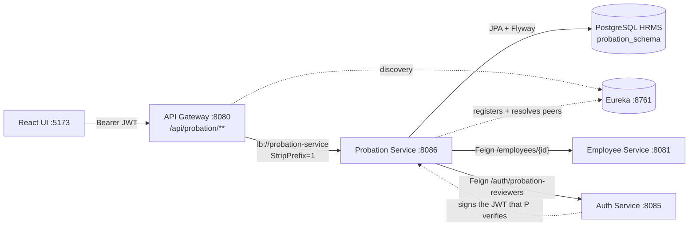
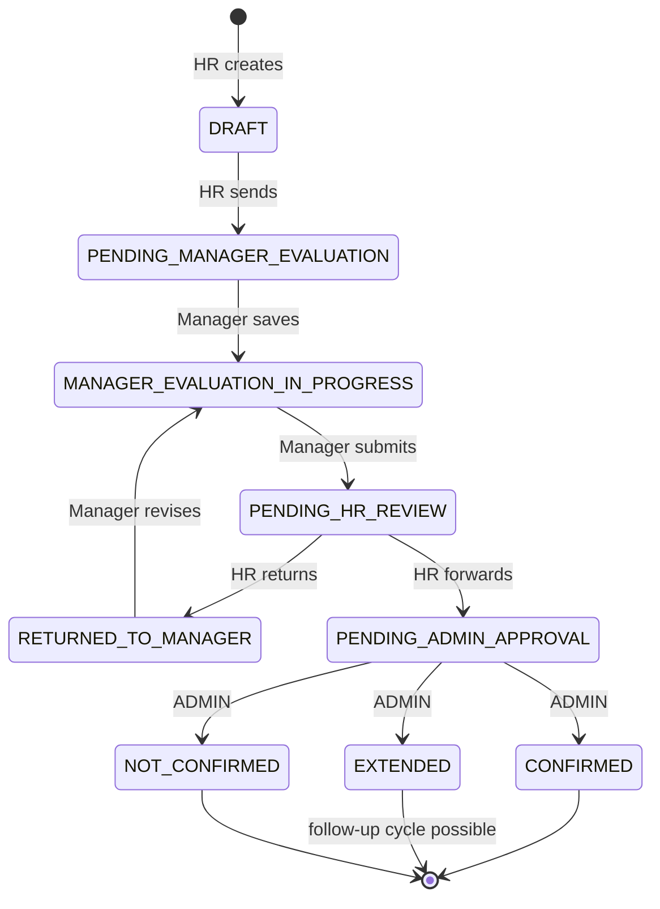

# Probation Service — Explained

> **Service** `probation-service` · **Port** 8086 · **Database** `HRMS` → `probation_schema`
> Written from the current source code, which remains the source of truth.

## 1. Overview

A **probation assessment** is the formal review of a new employee at the end of their trial
period. Instead of a verbal yes/no, the company records evidence: performance against fixed
criteria, the manager's recommendation, and the final administrative decision.

Companies need it because it protects both sides. The employee gets a documented, consistent
evaluation rather than an opinion; the company gets a defensible record if a confirmation or
an extension is later questioned.

This service owns that whole lifecycle. It stores assessments, enforces who may move them
forward, keeps an append-only history, and permanently freezes a record once a decision is
published. It does **not** own employee master data (`employee-service`) or accounts and
roles (`auth-service`) — it asks them over HTTP when needed.

## 2. Architecture



The browser only calls the gateway on `:8080`. The gateway matches `/api/probation/**`,
strips `/api`, and forwards to a healthy instance that Eureka reports. The service verifies
the JWT itself, applies role and ownership rules, then writes to `probation_schema`. Cross-
service data arrives through `EmployeeClient` and `ReviewerClient`, and `FeignTokenRelay`
forwards the **caller's own token**, so the downstream service authorises the same user
instead of a privileged super-client.

## 3. Workflow



`CONFIRMED`, `EXTENDED` and `NOT_CONFIRMED` are **terminal**.
`WorkflowRules.require()` rejects any further change, and a PostgreSQL trigger rejects it
again at SQL level. An `EXTENDED` case may be followed by a new cycle starting the day
after the original end date, linked via `previousAssessmentId`.

## 4. Technical explanation

**Layers.** `ProbationController` handles HTTP, `@PreAuthorize` and validation only.
`ProbationServiceImpl` holds role checks, ownership checks, `WorkflowRules` and
transactions. `AssessmentRepository` / `HistoryRepository` are Spring Data JPA.
`AssessmentMapper` produces three shapes: `detail` (internal), `outcome` (employee),
`evidence` (audit snapshot). `CurrentUser` + `JwtAuthenticationFilter` supply identity.
`GlobalExceptionHandler` returns one `{timestamp,status,error,message}` body.

```
HTTP → Controller → Service (role + ownership + rules) → Repository → PostgreSQL → Mapper
```

Every transition passes through `changed()`, which updates `updatedBy/updatedAt`, saves with
the optimistic-lock `version`, and appends an audit row — no path can move a status silently.

| Table | Holds | Enforced rules |
|---|---|---|
| `probation_assessments` | one row per cycle: employee, manager, dates, status, decision | no two overlapping active cycles per employee; `status` must match `final_decision`; trigger blocks `UPDATE`/`DELETE` once finalized |
| `probation_assessment_ratings` | 8 rows: criterion, weight, score 1–5, comment | `UNIQUE(assessment_id, criterion_code)`; scores 1–5; frozen after finalization |
| `probation_assessment_history` | action, previous→new status, actor, time, remarks, evidence JSON | append-only trigger — history can never be rewritten |

Flyway applies `V1`–`V3` at startup and Hibernate runs `ddl-auto=validate`, so entities and
schema must agree or the service refuses to start.

| API | Who | Purpose |
|---|---|---|
| `POST /assessments`, `PUT /assessments/{id}` | HR | create / edit a draft |
| `POST …/send-for-evaluation`, `…/return-to-manager`, `…/forward-for-approval` | HR | move the case forward or back |
| `PUT …/evaluation`, `POST …/submit-evaluation` | assigned manager | save scores, then submit |
| `POST …/decision` | **ADMIN** | confirm / extend / not confirm |
| `POST …/reassign` | ADMIN, HR | change the assigned manager |
| `GET /assessments`, `/manager/assignments`, `/me`, `/statistics` | scoped per role | queues, inbox, own outcome, dashboard |

Every mutating call must send the row's current `version`; a stale value returns **409**,
which is how two simultaneous editors are prevented from overwriting each other.

**Authentication.** `auth-service` signs the JWT; this service verifies the signature
locally with the shared `app.jwt.secret`, with no per-request call back.
`JwtAuthenticationFilter` accepts a token only with a subject, numeric `userId > 0`, a
non-null expiry, and **exactly one** role among `ROLE_ADMIN`, `ROLE_HR`, `ROLE_EMPLOYEE`;
otherwise the context is cleared and the answer is **401**.

| Action | ADMIN | HR | EMPLOYEE |
|---|---|---|---|
| Create / edit draft, send, return, forward | ❌ 403 | ✅ | ❌ 403 |
| Evaluate / submit | ❌ 403 | ❌ 403 | ✅ **only if assigned** |
| Final decision | ✅ | ❌ 403 | ❌ 403 |
| Reassign manager | ✅ | ✅ | ❌ 403 |
| Read any case / read own outcome | ✅ | ✅ | own only |

Three layers agree: the `SecurityConfig` URL rule, `@PreAuthorize` on the method, and
ownership checks in the service. **Ownership is never read from the request** — the employee
id always comes from the JWT's `employeeId` claim, so editing an id in the URL cannot reach
another person's record.

**Validation (400 unless noted).** Dates ordered and `reviewDueDate` inside the period · one
score per criterion, 1–5, each with a comment · strengths, improvement areas, development
recommendations and a manager recommendation required before submission · an extension needs
a reason **and** an end date after the current one · a reason is required for extension and
non-confirmation · the reviewer must be an enabled, employee-linked account and must not be
the employee themselves · referenced employee must exist (**404**).

## 5. Real-world example

*(Illustrative names; the flow matches the code.)*

1. **1 Aug — HR creates** an assessment for new engineer *Aarav*: period 1 Aug → 1 Nov,
   review due 15 Oct, *Priya* as reporting manager. The service confirms with
   `employee-service` that Aarav exists and with `auth-service` that Priya is eligible,
   snapshots the 8 criteria, saves `DRAFT`, and writes `CREATED`.
2. **HR sends** → `PENDING_MANAGER_EVALUATION`.
3. **Priya evaluates**: scores 4,4,3,4,5,4,3,4 each with a comment, plus strengths, gaps and
   a recommendation. Saving → `MANAGER_EVALUATION_IN_PROGRESS`; submitting runs
   `WorkflowRules.complete()`, stores the average and moves to `PENDING_HR_REVIEW`.
4. **HR returns it** because examples are thin → `RETURNED_TO_MANAGER`. Priya revises,
   resubmits, and HR forwards → `PENDING_ADMIN_APPROVAL`.
5. **3 Nov — ADMIN decides** `CONFIRMED` with a published comment. `decidedBy`,
   `decisionDate` and `publishedAt` are stamped in one transaction; the row is now read-only
   forever.
6. **Aarav opens My Probation** and receives a small payload: period, status, decision,
   published comment, revised end date. He never sees the manager's raw scores, HR's internal
   remarks, the administrator's private rationale, or the audit history —
   `AssessmentMapper.outcome()` strips them.

## 6. Key engineering decisions

- **Own service, own schema.** Probation changes more often than payroll, has distinct
  permissions and needs an immutable trail. Isolation means a bug here cannot corrupt another
  module. The cost — no cross-database foreign keys — is paid by storing plain ids
  (`employeeId`, `reportingManagerUserId`) and validating them over Feign.
- **Manager assignment is the security boundary.** The assignment lives on the row and
  `requireManager()` compares it with the JWT `userId`, so a manager cannot be impersonated
  through the request body. Reassignment revokes the old manager immediately while their
  evidence survives in history. "Employee is their own manager" is blocked in Java *and* by
  `CHECK (manager_employee_id <> employee_id)`.
- **Transitions live in one place.** `WorkflowRules` lists the statuses each action allows,
  so an early forward or a second submit returns **409** rather than corrupting state. The
  `@Version` field, the `CHECK` constraints and the triggers each enforce the same truth.
- **History is evidence, not logging.** Each transition stores an action, from/to status,
  actor and a JSON snapshot of scores and comments. Because the database refuses updates and
  deletes, a later correction cannot erase what the previous reviewer wrote.

## 7. Presentation script (≈75 seconds)

> "Probation Assessment handles a new joiner's end-of-trial review. It's its own microservice
> on port 8086 with its own schema, so it can evolve without touching payroll or employee
> data.
>
> There are four actors. HR creates the case and assigns a reporting manager. That manager
> scores eight fixed criteria from one to five with written comments, then submits. HR reviews
> it and can either send it back for rework or forward it. Only an admin makes the final call:
> confirm, extend, or not confirm. Finally the employee sees a short, curated outcome — their
> dates, the decision and the message HR wants them to read, not the internal scores or
> remarks.
>
> Two things make it safe. First, identity always comes from the JWT, never from the request,
> and the manager check is against the assignment stored on the row — so nobody can claim
> someone else's case. Second, a finalized assessment is frozen: the service refuses the
> change and a database trigger refuses it again, so the audit trail stays honest.
>
> One practical note: every update must send the row version, and a stale version comes back
> as 409 — that's how we stop two people overwriting each other."

## 8. Known gaps — not yet finished

| Area | Current state |
|---|---|
| ADMIN authoring | create / edit / send / return / forward are `hasRole('HR')` only → ADMIN gets **403**; a missing HR account blocks the pipeline |
| Employee visibility | `/me` returns `DRAFT` and in-progress rows (with internal id), not only published outcomes |
| Response contract | `GET /assessments/{id}` is typed `Object` and returns two different shapes (employee outcome vs internal view) |
| Method locks | `get`, `list`, `me`, `manager/assignments`, `employee history`, `evaluate`, `submit`, `capabilities`, `criteria` have no `@PreAuthorize`; they rely on service checks alone |
| Corrections | a published decision cannot be corrected — all outcomes are terminal, and a follow-up cycle is only allowed after an `EXTENDED` |
| Tests | the integration suite is not hermetic (real test DB, no rollback) and has reported different results on identical runs |
| Criteria weights | all eight weights are `1` in policy version `"1"`, so the weighted average is currently a plain mean |

The UI exists (`/probation`, `/probation/assessments`, `/manager-evaluations`,
`/my-probation`) and mirrors these role gates, but browser-side hiding is only user
experience — the backend rules above are the real boundary.
