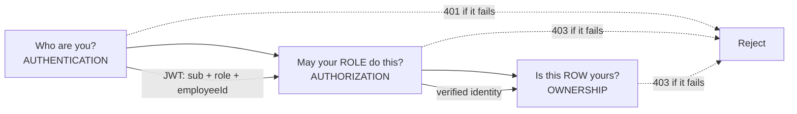
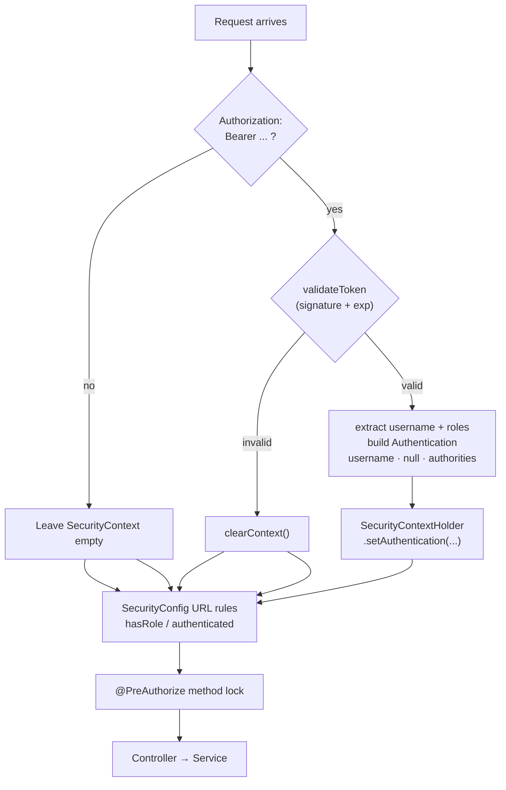
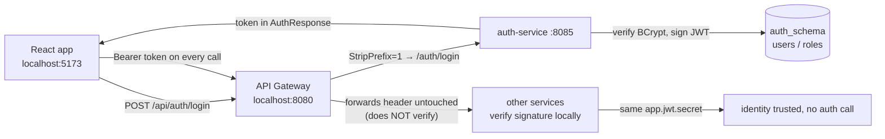
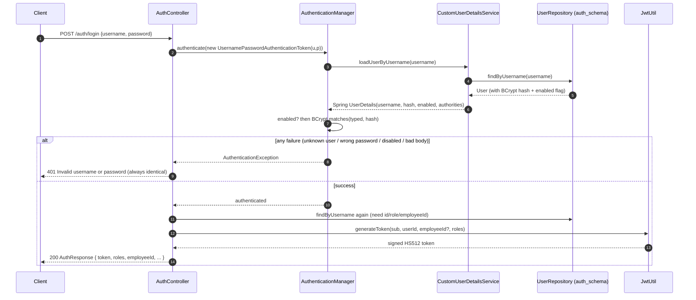
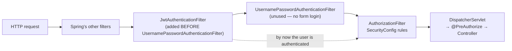
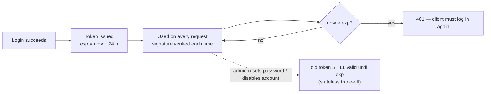
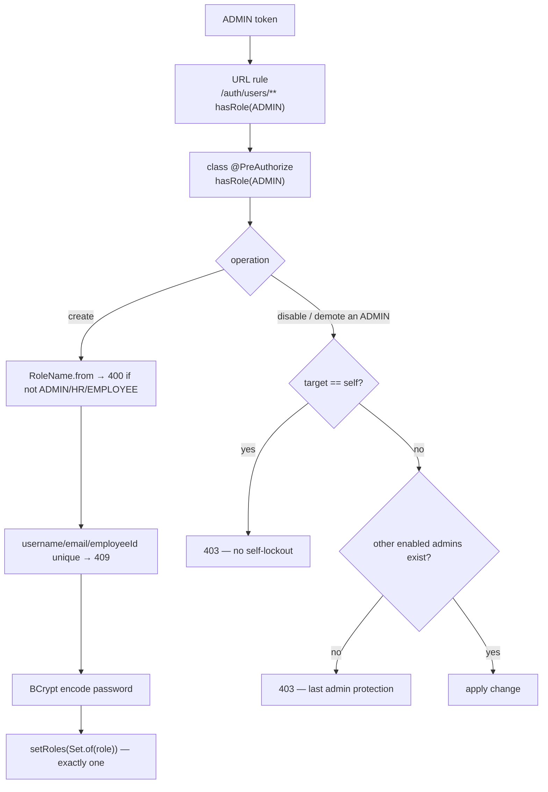
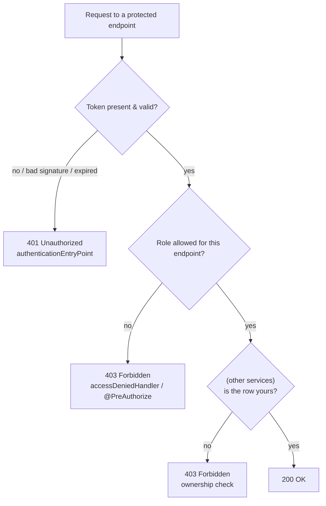
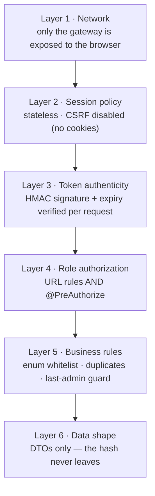

# Auth-Service Security — Concepts & Flow Diagrams

> Scope: `auth-service/src/main/java/com/example/microservices/auth/**`
> Companion docs: [../services/AUTH_SERVICE.md](../services/AUTH_SERVICE.md) ·
> [../04_SECURITY_AND_ROLES.md](../04_SECURITY_AND_ROLES.md) ·
> [../learning/SPRING_SECURITY_AND_JWT.md](../learning/SPRING_SECURITY_AND_JWT.md)
>
> This document explains **why** the security works, not just what the code does.
> Every diagram is derived from the current source.

---

## 1. The three questions security answers

Most people say "authentication and authorization". This project actually has
**three** distinct questions, and they are answered in three different places:

| # | Question | Name | Where it is answered | Failure code |
|---|---|---|---|---|
| 1 | *Who are you?* | **Authentication** | `JwtAuthenticationFilter` + `CustomUserDetailsService` + BCrypt | 401 |
| 2 | *May your **role** touch this **kind** of endpoint?* | **Authorization** | `SecurityConfig` URL rules + `@PreAuthorize` | 403 |
| 3 | *Is this specific **row** yours?* | **Ownership** | Service layer, using the `employeeId` claim (other services) | 403 |

auth-service answers #1 completely and #2 for its own endpoints. #3 lives in
employee/leave/attendance/payroll, but the raw material for it — the signed
`employeeId` claim — is manufactured **here** at login.



---

## 2. The building blocks (the concepts, one at a time)

### 2.1 Password storage — BCrypt

Plain passwords are never stored. `UserServiceImpl` / `DataSeeder` run every
password through `BCryptPasswordEncoder`, which produces a one-way hash like
`$2a$10$Xk...`.

Why BCrypt and not SHA-256/plain?

- **Slow on purpose.** The cost factor (`10` → 2¹⁰ rounds) makes each guess
  expensive, so brute-forcing a stolen hash table is impractical.
- **Random salt per hash.** Two users with the same password get *different*
  hashes, so precomputed rainbow tables are useless.
- **One-way.** You can only *verify* a login (`encoder.matches(raw, hash)`),
  never recover the original. There is no "decrypt".

> The plain password exists **only** as a method parameter. It is never logged,
> never persisted, never returned in a DTO.

```
"admin123"  ──BCrypt──►  "$2a$10$N9qo8uLOickgx2ZMRZoMye..."   (stored)
                          ▲ different every time you encode, even for the same input
```

### 2.2 Proof of identity across requests — JWT (stateless)

HTTP is stateless: the server forgets you between requests. Two classic answers:

- **Sessions** — server stores a session in memory/Redis; cookie points to it.
- **JWT** (this project) — the server stores *nothing*. The client holds a
  **signed** token that carries its own identity, and every service verifies the
  signature locally with a shared secret.

`JwtUtil` is the only class that creates or reads tokens.

```
header.payload.signature
   │       │        └─ HMAC signature over header+payload (proves it's genuine)
   │       └────────── claims: sub, userId, roles, employeeId, iat, exp  (Base64, READABLE!)
   └────────────────── {"alg":"HS512"}
```

**Signed ≠ encrypted.** Anyone can Base64-decode the payload and read it. That
is why **no password or secret is ever placed in a claim**. Changing a single
character of the payload invalidates the signature, so nobody can forge it
without the secret.

### 2.3 The claims this service issues (the contract the whole project trusts)

| Claim | Meaning | Notes |
|---|---|---|
| `sub` | username | the proven identity |
| `userId` | `users.id` in `auth_schema` | stable even if username is renamed |
| `roles` | `["ROLE_ADMIN"]` \| `["ROLE_HR"]` \| `["ROLE_EMPLOYEE"]` | **exactly one** |
| `employeeId` | linked employee record | **omitted entirely** (not `null`) for admin/HR |
| `iat` / `exp` | issued at / expires at | 24 h by default |

### 2.4 Reading the token on every request — the filter chain

`JwtAuthenticationFilter` runs once per request, **before** the authorization
rules. It does not *reject* anything by itself; it only decides whether to fill
Spring's "who is calling?" slot (`SecurityContextHolder`).



Key design choice: on a bad token it **continues the chain unauthenticated**
rather than erroring. This lets the one public endpoint (`/auth/login`) still
work even if a stale token happens to be attached, while protected endpoints are
then refused by the rules with a clean `401`.

### 2.5 Where the caller's identity is stored — `SecurityContext`

Once verified, the filter parks a `UsernamePasswordAuthenticationToken` in
`SecurityContextHolder`:

- **principal** = username
- **credentials** = `null` (already proven — the raw password is never kept)
- **authorities** = `["ROLE_ADMIN"]` etc., taken straight from the token

`AuthServiceImpl.getCurrentUser()` and `UserServiceImpl.currentUsername()` read
that slot. **Identity always comes from the token, never from the request body** —
this is what makes ownership checks trustworthy downstream.

### 2.6 The role model — a closed whitelist

`RoleName` is a compile-time enum: `ADMIN`, `HR`, `EMPLOYEE` and nothing else.
`RoleName.from("SUPERUSER")` → `InvalidRoleException` → **400**, so an invented
role can never reach the database. Each account holds **exactly one** role
(`setRoles(Set.of(role))` *replaces*, never accumulates).

The short name (`ADMIN`) maps to the Spring authority (`ROLE_ADMIN`) in one
place — `RoleName.toAuthority()` — so the two spellings can never drift.

---

## 3. The access map (what is public and what is locked)

Only **one** endpoint in the entire system is public.

| Endpoint | Rule | Who |
|---|---|---|
| `POST /auth/login` | `permitAll()` | **anyone** (the only public door) |
| `GET /auth/me` | `authenticated()` | any logged-in role |
| `/auth/users/**` | `hasRole("ADMIN")` **+** class `@PreAuthorize` | ADMIN |
| anything else | `authenticated()` | any logged-in role |

There is **no `/auth/register`**. Public signup was removed: accounts are created
by an ADMIN. `DataSeeder` solves the bootstrap problem by seeding the first
admin.

---

## 4. Flow diagrams

### 4.1 The complete trust picture



The gateway is a dumb pipe for the token — the services verify it themselves.
This is why one shared signing secret is the entire trust model.

### 4.2 Login flow (issue)



**Anti-enumeration:** unknown user, wrong password, and disabled account all
produce the *same* vague `401`. Telling them apart would let an attacker discover
which usernames exist.

### 4.3 Every protected request (verify)

```mermaid
sequenceDiagram
    autonumber
    participant C as Client
    participant F as JwtAuthenticationFilter
    participant SC as SecurityContext
    participant R as SecurityConfig rules
    participant P as @PreAuthorize
    participant S as Service layer

    C->>F: GET /auth/me  (Authorization: Bearer eyJ…)
    F->>F: strip "Bearer ", validateToken(signature + exp)
    alt invalid / missing
        F->>SC: leave empty
    else valid
        F->>F: extract username + roles
        F->>SC: setAuthentication(username, null, [ROLE_…])
    end
    F->>R: continue chain
    R->>R: /auth/users/** needs hasRole(ADMIN); /auth/me needs authenticated
    alt not satisfied
        R-->>C: 401 (no identity) or 403 (wrong role)
    else satisfied
        R->>P: method lock where present (UserController)
        P->>S: identity read from SecurityContext (NOT request body)
        S-->>C: 200
    end
```

### 4.4 Filter chain ordering (why order matters)



If the JWT filter ran *after* the authorization filter, the rules would see an
empty context and reject every request. `addFilterBefore(...)` is what guarantees
the identity is known in time.

### 4.5 JWT anatomy — a real example

```
HEADER   {"alg":"HS512"}                                        → which algorithm
PAYLOAD  {"sub":"employee",
          "userId":3,
          "roles":["ROLE_EMPLOYEE"],
          "employeeId":1,                                        → absent for admin/HR
          "iat":1760000000,
          "exp":1760086400}                                      → dead after this instant
SIGNATURE  HMAC-SHA512( base64(header) + "." + base64(payload), app.jwt.secret )
```

jjwt picks the strongest HMAC the secret length allows (≥32 B → HS256, ≥48 → HS384,
≥64 → HS512). The demo secret is 75 chars → **HS512**.

### 4.6 Token lifecycle



Because the server stores no token state, **there is no revocation**: a password
reset or account disable does not kill already-issued tokens. They die only at
`exp` (or when the client discards them). Role/ownership checks still run per
request, so a disabled user cannot gain new power — but they can keep using their
existing token until it expires. See §6.

### 4.7 ADMIN account management (with the lockout guards)



Two independent locks on `/auth/users/**` (the URL rule **and** the class-level
`@PreAuthorize`) mean a future route accidentally mapped outside the URL pattern
still cannot open account creation to the world.

### 4.8 Decision tree — which failure code and why



**401 = "I don't know who you are." 403 = "I know who you are, and no."** The
frontend relies on this: a `401` triggers an auto-logout + redirect to `/login`,
while a `403` is shown as "you are not allowed" without logging the user out.

### 4.9 Defense in depth — the layers



An attacker must defeat **every** layer; a single mistake in one is caught by the
next.

---

## 5. How each common attack is handled

| Attack | Mitigation in this code |
|---|---|
| **Password theft from DB** | BCrypt one-way hash + per-hash salt — stolen dump is not directly usable |
| **Token forgery** | HMAC signature with a server-only secret; one flipped payload char → `401` |
| **Token tampering (privilege escalation)** | `roles` is signed; changing `EMPLOYEE`→`ADMIN` breaks the signature |
| **User enumeration** | Unknown user / wrong password / disabled → identical vague `401` |
| **Privilege escalation via API** | Roles accepted only on ADMIN-only endpoints; `RoleName.from` whitelist (400); one role, replaced not accumulated |
| **Admin lockout** | Self-disable and last-enabled-admin demote/disable → `403` |
| **Certificate/route drift opening access** | Double lock: URL rule **and** `@PreAuthorize` |
| **Hash leakage via API** | `UserMapper` → `UserResponse`/`AuthResponse`; the entity never crosses the boundary |
| **SQL injection** | Spring Data JPA parameterised queries — no string-built SQL |
| **Malformed input** | Bean Validation (`@NotBlank`, `@Email`, `@Size`, `@Pattern`) → `400` before logic runs |

---

## 6. Known gaps & hardening recommendations

These are honest observations about the current code, useful for a security review.

| # | Gap | Risk | Suggested hardening |
|---|---|---|---|
| 1 | **Signing secret is committed** in `application.properties` (`app.jwt.secret=…`) | Anyone with the repo can forge tokens | Move to an env var / secret manager; rotate; never commit real secrets |
| 2 | **DB password committed** (`spring.datasource.password=…`), despite the comment claiming otherwise | Credential leak | Env var (`${DB_PASSWORD}`) |
| 3 | **No token revocation** | Password reset / disable does not kill live tokens | Short-lived access tokens + refresh tokens, or a token version/`jti` deny-list |
| 4 | **No login rate limiting / lockout** | Online brute force | Per-IP / per-account throttle, exponential backoff, CAPTCHA |
| 5 | **Token stored in `localStorage`** (frontend) | XSS can exfiltrate it | Prefer `httpOnly` cookie or strict CSP + short expiry |
| 6 | **24 h token lifetime** | Long window for a stolen token | Shorter access token + refresh flow |
| 7 | **Weak demo passwords** (`admin123`, `hr123`) seeded | Default credentials | Force password change on first login; don't seed in production |
| 8 | **Generic `500` handler echoes `ex.getMessage()`** | May leak internals | Log the detail server-side, return a fixed message |
| 9 | **Gateway does not verify JWTs** | Token validated only per-service | Validate at the gateway too (defense in depth) |

None of these break the learning design — they are exactly the trade-offs a real
review would surface.

---

## 7. One-minute mental model

> auth-service is the **only** issuer of identity. Login verifies a BCrypt hash and
> signs a 24-hour HS512 token carrying `sub`, `userId`, exactly one role, and
> `employeeId`. Every other request is authenticated by re-verifying that
> signature in a filter, authorized by role rules in two independent places, and —
> elsewhere — checked for row ownership using the signed `employeeId`. Exactly
> three roles exist, only `/auth/login` is public, an ADMIN creates all accounts,
> and the system guards against self- and last-admin lockout. The whole trust
> model rests on one shared secret.

---

## 8. Quick revision

1. Three questions: **authentication (401)**, **authorization (403)**, **ownership (403)**.
2. `POST /auth/login` is the only public endpoint; there is no signup.
3. BCrypt: slow, salted, one-way — verify only, never decrypt.
4. JWT is **signed, not encrypted** → never put a secret in a claim.
5. `JwtAuthenticationFilter` fills `SecurityContext`; it does not reject.
6. `/auth/users/**` is double-locked (URL rule + `@PreAuthorize`).
7. Roles are a closed enum; one per account; replaced, never accumulated.
8. Login failures are deliberately identical → anti-enumeration.
9. Stateless means **no revocation** — tokens live until `exp`.
10. Identity always comes from the token, never from the request body.
```
